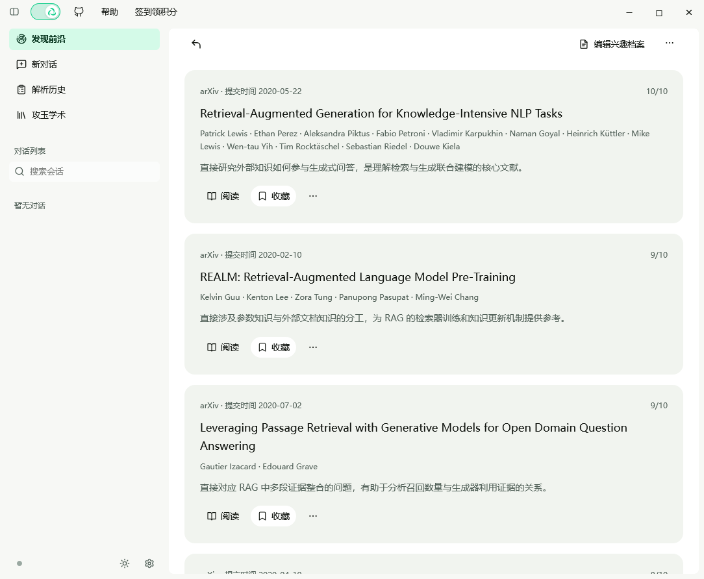
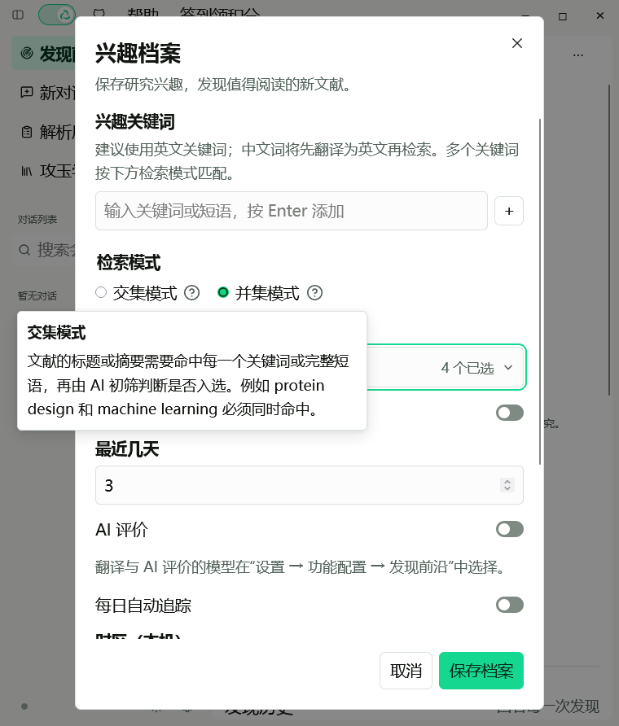
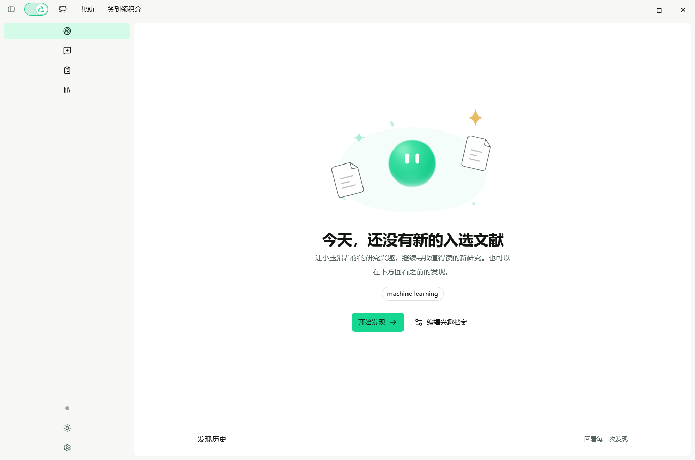

# Jadense in Zotero 使用指南

[返回 README](../README.md) · [Zotero 入门](zotero-guide.md) · [FAQ](faq.md)

- [0.6.13.12 快速解析：本机版面统计、单篇按需深读（有界摘录 + 单独一次派发）](#update-061312)
- [0.6.13.11 快速解析：代码判定收紧、附录只列一级标题、评价改为百分制、畸形 JSON 不再整篇报废](#update-061311)
- [0.6.13.10 快速解析：链接可点击、附录小节可跳页](#update-061310)
- [0.6.13.9 快速解析：附件真的读到了，失败也说得明白](#update-06139)
- [0.6.13.8 快速解析：读超链接注释、证据行逐篇可见、有附录就说有](#update-06138)
- [0.6.13.7 快速解析：整篇取证、回执每轮都报、单篇不出对比](#update-06137)
- [0.6.13.6 快速解析：勾选图标同步、跨行链接粘合与附录识别](#update-06136)
- [0.6.13.5 快速解析：评价档位锚点与开源链接发现](#update-06135)
- [0.6.13.4 快速解析：弹出列表框、默认 6 篇与输出预算](#update-06134)
- [0.6.13.3 快速解析：思路／实验流程、开源标注与逐篇评价](#update-06133)
- [0.6.13.2 收藏夹快速解析](#update-06132)
- [0.6.13.1 磁盘回收、译文自动保存与错误类型](#update-06131)
- [0.6.13 任务继续、解析状态与阅读字号（候选版）](#update-0613)
- [0.6.0 对照翻译与引擎配置](#pdf-translation-060)
- [0.6.2 更新提示与阅读入口](#release-062)
- [0.6.10 引擎存储、BYOK 档位与升级](#update-0610)
- [0.6.9 简阅、模型与翻译反馈](#simple-reading-069)

## 0.6.13.12：本机版面统计与单篇按需深读（2026-10-27）

这一版解决的是同一件事的两面：**摘要级综述判不准「有没有做消融、实验够不够」，但整篇正文又不能外发。** 折中办法是把"能数出来的"在本机数掉，把"必须读正文的"留给用户逐篇点。

- **版面统计（本机数出，随批量综述一起外发）**：扫描附件时顺手统计每篇的一级小节标题（最多 12 条）、图数量、表数量、参考文献条数，以及三组关键词命中次数——「消融／ablation」、「基线／baseline／state-of-the-art／compared with」、「人工评测／user study／human evaluation」。送出去的只有**标题文字和计数**，正文一句不出机器。提示词里这一行标明是「本机数出，非模型判断」，模型不得把计数当成自己的阅读结论；卡片与「复制全文」里同一行原样显示，参考文献数不出来时写「未数出」而不是 0。计数上限 99（参考文献 999），历史记录回读时字段类型不对就整条丢掉，不会凭坏记录造出一份假统计。
- **一级标题识别按 35 篇真实 PDF 校准**：以前会被当成标题的东西现在都不收了——首页单位行（`1. School of …`、`3 Shanghai AI Laboratory`）、每页重复的页眉（`2 自动化学报 51 卷`）、目录行（`Conclusion 23`）、IEEE 段落标签（`3) 进行目标识别`）、带引文标记的正文句（`… MOSS [7] …`）、小型大写碎片（`1. 1 M`）、含逗号的中文正文句。页眉要在主循环**之前**剔除：它同样以编号开头，会把阿拉伯序号吃掉，真标题随后全被判成「序号回退」，整篇从 7 节缩成 2 节。校准后 35 篇全部能切出摘录，中英日文各版式无一条假阳性。
- **单篇深读（默认不启用，点一次发一次）**：批量综述结束后，每篇卡片下方有「深读这篇（单独一次请求）」按钮。点下去**先在本机切摘录，什么都不发送**，然后弹确认框逐条报清：这是单独一次请求、单独计费，送出多少字正文摘录、是哪几节（节首还是节尾、在第几页）、本机为切它读了多少页，并写明「摘录之外的正文、图表、公式与附录都不发送」。你确认后才有那一次派发；取消或切不出摘录都停在本地，状态行写「没有发送任何内容」。
- **摘录是硬上限的**：最多 3 节、每节最多 400 字、总计最多 1200 字。取哪几节按名实相符优先——引言取**节尾**（贡献段在末尾）、方法／结论／实验取**节首**，名字认不出来时按文档顺序补齐，标题始终照实写。整节只剩一行残句（少于 20 字）时跳过，不拿它占槽位。版面断词（`configu-` + `ration`）会拼回，避免送残句。一篇有多个附件时取读到页数最多的那份。
- **返回结果与跳页**：深读结果按结构化字段解析成「一句话／方法细节／证据强度／可复现性／局限／评分依据」，评分沿用批量综述同一把尺子（0–100，同一批锚点）；每节都带页码与附件 ID，点一下在 Zotero 阅读器里翻到那一页。提示词明确「不得假装读过未送来的部分」，模型返回无法解析时保留原文文字，不猜任何字段。
- **计费与非幂等契约与批量综述一致**：深读是一次真实计费请求，上次执行结果未确认时插件**不会自动重发**，只弹一次「已核对，授权重发」的确认；授权后沿用同一会话 ID 重发一次。错误投影仍只给错误码／HTTP 状态／类名，不回显提供商正文或凭据。结果写回本机历史里那一篇（不新增记录、不重排），记录或那一篇已被清空时如实提示「没能写入本机历史，结果仍在本窗口，请及时复制」。
- **对批量综述的影响：零**。不点深读，这一版只多了版面统计那一行；一次派发、篇数预算、隐私围栏都没有变。

## 0.6.13.11：代码判定收紧、附录只列一级标题、评价改为百分制、畸形 JSON 不再整篇报废（2026-10-27）

- **「代码明确给出」不再靠猜**：只有给出仓库网址（github、gitlab、huggingface、zenodo 等；题录里写成 `github.com/x/y` 也算），或明确写了「源代码已开源／已发布／可获取」，才显示「明确给出」。项目主页、数据集网站、论文落地页都不算；「将开源」「审稿后开源」这类承诺也不算。模型若在没有证据时写了有代码，客户端会改回「未见说明」。把鼠标停在代码／数据徽章上，会显示这条判定口径。
- **附录只列一级标题**：卡片和复制文本统一写成「附录存在，包括以下部分：1. … 2. … 3. …」，不再把 `A.1` 子小节、坐标轴刻度或正文句子混进来。小节按钮仍带页码，点一下跳到原文那一页。
- **真实 PDF 的漏检与误判**：参考文献里的作者行（`A. Dai,`）不再被当成小节；附录从 `VII` 这样的续编开始时也能取到；编号单独成行、小型大写被拆成碎片（`VII.` + `D` + `ATA`）时能拼回；标题在行尾断词（`Reproducibil-` + `ity Details`）时能接回。复检 6 篇真实 PDF，四篇有附录的篇目节数与原文一致，两篇没有附录的结果为空。
- **评价改为 0–100 分**：问题价值、方法创新、证据强度、可复现性、应用潜力各 20 分，写作、排版、图表、期刊、引用都不计分。档位由分数折算（80+ 高、65–79 中、50–64 低、其余无法判断），同一批文献用同一把尺子；只有题录或摘要被截断时分数上限 45。卡片标题旁显示 `72/100`，悬停可看评分口径与依据。旧历史记录里的档位仍能正常显示。
- **模型输出有中文标点也不再整篇报废**：以前只要 JSON 里出现一处解析不了的字符（漏转义的内嵌引号、写成全角的 `，：`、条目被截断），界面就退回「未能解析为结构化综述，已保留模型返回的文字供阅读」，四篇卡片、评价、对比全都没了。现在按三级递进处理：原样解析 → 语法修复（字符串里漏转义的引号补成 `\"`，字符串**外**的全角 `，：｛｝［］` 还原成半角，尾逗号与裸控制字符照旧）→ 逐字段恢复（把还能读的顶层字段和数组条目取回来，彻底坏掉的条目丢弃）。句子内部的中文逗号有前瞻判断，不会被当成分隔符切错。恢复成功会如实提示「已逐字段恢复，并跳过 N 处无法解析的内容」；从坏条目恢复出的空壳不算覆盖，会写进「有 N 篇未被覆盖」；截断在完整值之后时，已经到达的逐篇评价也能恢复出来。
- **边界不变**：外发仍只有题录、摘要、链接文本与附录一级标题，PDF 正文一句不出机器；扫描不打开任何链接；一次派发、BYOK 未确认不重发、错误脱敏都没有改动。解析加固只在本机对**已经收到的**返回文本做修复，不会因此多发一次请求。

## 0.6.13.10：链接可点击、附录小节可跳页（2026-10-27）

- **本地链接变成按钮**：卡片与「复制全文」里的链接行（复制文本仍是纯文本）点一下经 `Zotero.launchURL` 交给系统浏览器打开。只接受 http/https，历史记录里混进的 `javascript:` 之类只显示原文、不成为动作。扫描过程本身依旧不打开任何链接——只有你点下去才会打开。
- **附录小节跳到原文**：扫描时每个小节标题会连同它所在的页和附件一起记下。卡片上的小节显示为「A. Motion Dataset Selection 第 7 页」这样的按钮，点击调用 `Zotero.Reader.open(附件 itemID, { pageIndex: 页 − 1 })`：附件已经开着就地翻页，没开就新开标签并定位。这样「有附录」不再只是一句结论，可以直接核对原文。
- **旧记录不假装能跳**：0.6.13.10 之前保存的历史只有小节标题、没有页码，标题仍是纯文本；新记录保存页码与附件 ID，重开旧综述也能跳。读取时会校验页码与附件 ID 为正整数、标题必须确实在已保存的小节里，坏记录不能凭空造出可点小节。
- **边界不变**：页码与附件 ID 只在本机流转，不进请求载荷、不进复制文本；外发仍只有题录、摘要、链接文本与附录小节标题，PDF 正文一句不出机器。一次派发、BYOK 未确认不重发、错误脱敏都没有改动。

## 0.6.13.9：附件真的读到了，失败也说得明白（2026-10-27）

- **根因是 Zotero 10 的缓存语义，不是 PDF 解析**：`Zotero.Items.get` 与 `getByLibraryAndKey` 只查内存缓存，条目已登记但未装载时直接抛 `UnloadedDataException`；`collection.getChildItems()` 返回的条目也没装载自身的 `childItems`，`getAttachments()` 一样会抛。旧代码把两处异常吞成「没有附件」，于是界面写出「读了 0 页 · 发现链接 0 条 · 未见附录」。现在改用 `getAsync`／`getByLibraryAndKeyAsync` 落库解析，并在 `getAttachments()` 失败时用 `loadDataType('childItems')` 补载后重试一次。
- **五种结论分开说**：`parsed`（读过）、`noAttachment`（条目确实没有 PDF）、`oversize`（超过 60 MB）、`unreadable`（读盘或解析失败）、`unavailable`（条目或附件列表读不出来）。只有真正拿到附件列表的篇目才标「已扫描」；`unavailable` 不标记，下次生成会重试。卡片、徽章与回执分别写「未找到 PDF 附件」「PDF 读取或解析失败」「未能读取附件（重新生成会重试）」和「N 篇未能读取附件列表」。
- **提示词知道附件读没读到**：每篇多一个 `scan` 字段（`read`／`no-pdf`／`failed`／`off`）。只有 `read` 时，空的 `links`／`appendix` 才能理解成「已读页面里没有」；其余状态模型不得断言这篇没有链接、没有附录或没有开源代码，也不得写「附件链接：无」。附录说明同步改成「整篇、最多 80 页」。
- **失败留证据**：条目解析、`childItems` 补载、读盘、解析四步各有诊断阶段名，写进 `jadense-diagnostics`；快速解析窗口复用宿主上同一个诊断实例，不会与工作台互相覆盖。
- **历史与边界**：历史记录保存扫描结论；0.6.13.8 及更早「标了已扫却 0 页」的记录一律显示「未能读取附件」。仍只外发题录、摘要、链接文本与附录小节标题，正文不出机器、不打开链接，一次派发与 BYOK 未确认不重发的契约不变。

## 0.6.13.8：读超链接注释、证据行逐篇可见、有附录就说有（2026-10-27）

- **文字层抽不到时，改读 PDF 的超链接注释**：不少论文把项目主页排成图形、分段文字或带字形问题的字体，`getTextContent()` 拿到的文字里根本没有那串网址——`https://expressive-humanoid.github.io` 就是这样漏掉的。本机 36 个 PDF 的注释里共有 610 条链接，572 条在文字层里找不到对应网址。现在每篇附件的第 1～2 页会调用 `getAnnotations({ intent: 'display' })` 取 `Link` 注释，与文字层合并去重。复检：注释通道多找出 8 条链接、涉及 7 篇论文。
- **只读前两页，且继续过滤噪声**：注释里的链接不受版式约束，参考文献列表里也常有仓库地址（体检里一条 `github.com/...` 就在第 9 页，属于引文）。只看第 1～2 页即可覆盖首页页脚、摘要旁与标题下的项目页；orcid、crossmark、YouTube、X、Bilibili 这类身份／视频／社交站点丢掉，期刊自己的 `/article/doi/…` 落地页也不算资源。每篇链接上限 4→6。
- **每篇都给一行本机证据**：结果卡片里固定显示 `附件：读了 13 页 · 发现链接 1 条 · 附录小节 3 节`；没有就明说「未见链接」「未见附录」，本次没扫的写「附件：本次未扫描」。文献清单的徽章同样补上「附件已扫 N 页，未见链接」与「有附录（未列小节）」。看不到内容时，这一行会告诉你到底是没扫、扫了没找到、还是只找到了附录。
- **「有附录但小节没编号」也照样说**：真实 PDF 里 `Appendix`／`Supplementary Material`／`附录` 后面常是整段正文或不分编号的小节，旧版会当成「没有附录」。现在这类论文带 `appendixMarked` 标记，卡片与徽章显示「有附录（未列小节）」，提示词允许模型说这篇有附录，但禁止说有几节、禁止猜标题；扫描回执补一句「另有 N 篇读到附录标记但没排出小节标题」。体检：36 个 PDF 里读到附录标记 8 篇、排出小节标题 6 篇（上一版 3 篇）。
- **历史记录跟着复原**：新记录保存 `attachmentScanned`／`scanPages`／`appendixMarked`，重开时证据行与徽章与当时一致；旧记录没有这些字段就不显示证据行。
- **边界不变**：注释通道只取 URL 文本，PDF 正文依旧一句不出机器，也不打开任何链接；仍然一次派发、沿用「文献解析」功能模型，BYOK 未确认结果不自动重发，错误只给错误码／HTTP 状态／类名。

## 0.6.13.7：整篇取证、回执每轮都报、单篇不出对比（2026-10-27）

- **不再只读首尾页**：拿插件自己那套函数扫本机 36 个真实 PDF 做体检，抓到一类确凿漏检——一篇 15 页的论文有 8 个附录小节，全在中间页，「第一页＋最后六页」一个都碰不到。现在整篇都读（超过 80 页取首尾两半）。代价实测：27 页 45.7 MB 的 PDF 全文抽取 313 ms，这批里最慢的一篇 972 ms，相比模型输出等待可以忽略。复检结论：读取证页与读全文的差值为**链接 0 条、附录小节 0 节**。
- **OpenReview 论文页不再算发现**：上一版漏检清单里三分之二其实是 `openreview.net/forum?id=…` 这类噪声，和 arXiv 同类，指向的还是这篇稿子。现在它进落地页排除，也不再占每篇 4 条链接的额度。同时去掉以 `-`／`_` 收尾的断行残串（`https://github.com/hill-`）和参考文献域名（semanticscholar、mlr.press、acm.org、ieee.org、springer、citeseerx、eprints 等）。
- **扫描回执每轮都说**：上一版只在有附件被跳过时才开口，于是「扫过、确实没有」和「根本没扫成」在界面上长得一样。现在状态行固定报：读了几个 PDF、共多少页、发现几条链接、几篇有附录小节，以及没扫到的三种原因（没有可读 PDF 附件／超过 60 MB／读取或解析失败）。**下次再看到"什么都没解析出来"，这一行会直接说明卡在哪一步。**
- **只有一篇时不出「横向对比」**：单篇没有对比对象，硬要模型写只会把一篇拆成两半自比。提示词按篇数分支，单篇明确要求 `comparison` 返回空数组，示例 JSON 里也不再摆一条对比。
- **围栏不变**：多读几页只发生在本机，外发的仍然只有题录、摘要、链接文本与附录小节标题，正文一句不出机器，也不打开任何链接；一次派发、沿用「文献解析」功能模型，BYOK 未确认不重发、错误只给错误码／HTTP 状态／类名。
- **What changed**: evidence scanning reads the whole PDF (capped at 80 pages) after an audit of 36 local PDFs found eight appendix sections sitting on middle pages that head-plus-tail never reaches; the audit now reports zero links and zero appendix sections missed versus full text, and costs 313 ms for a 27-page 45.7 MB file. OpenReview paper pages join arXiv as landing pages rather than resource evidence, and line-break fragments plus citation hosts are dropped. The scan summary is printed on every run, not only when something fails, so "nothing found" can be told apart from "nothing scanned". A one-paper review no longer emits a comparison table. Privacy and billing are unchanged.

## 0.6.13.6：勾掉了图标也得跟着掉，链接要真的抽得到（2026-10-27）

- **「全不选」图标同步**：上一版清空的是勾选集合，但每行的复选框仍按清单初始状态显示，于是提示写「本次发送 0 篇」、下面一排全是勾。现在「全选」「全不选」共用同一个 `syncChecks`，只认 `included` 集合重画图标，文字和图标读同一份状态。
- **跨行网址粘合**：PDF 排版常把 `https://` 留在行尾、域名换到下一行，pdf.js 取回的是两段分开的文字，旧正则一条也匹配不上。这就是「第一页明明印着项目主页却什么都没识别到」的原因。现在只有断口后面是主机名形状（`域名.顶级域`）才粘合，`https://` 后面接普通词的行尾断句不会被当成链接——回归用例分别覆盖 `Our project website is available at https:// yushi-du.github.io/COLA/`（抽到）与 `https://\nWe present a method`（不抽）。
- **arXiv 与 DOI 落地页不算发现**：arXiv 地址只是这篇论文的托管页，指向的还是同一份稿子，不能当开源证据；`doi.org` 与 `doi.acm.org` 这类以 `doi.` 开头的解析器前缀同理。此外去掉只有域名没有路径的仓库根链接（`https://github.com` 指向空页），以及截断在域名中间的残串（去掉 `www.` 后没有点号，如 `https://www.agilityrobotics`）。每篇上限 3→4 条，仓库、项目主页与数据集站点经常同时出现。
- **附件扫描放宽**：单附件 20 MB→60 MB，尾页 3 页→6 页。会议论文 PDF 常在 25～50 MB，旧上限会把最该扫的附件静默跳过；附录小节标题也往往排在正文之后好几页。实测那篇 Expressive Whole-Body Control for Humanoid Robots（22,772,375 字节、13 页）旧版因超限整个跳过，本版第一页抽出 `https://expressive-humanoid.github.io`，尾页抽出 `A. Motion Dataset Selection`、`B. Additional Training Details`、`C. Additional Real World Results Visualization`。
- **附录小节进证据链**：读到 `Appendix`／`Supplementary Material`／`附录` 标记行后，形如「A. Motion Dataset Selection」「A. 额外实验」的标题会被收集（最多 8 节、重复去重），作为每篇的 `appendix` 字段与 `links` 一起送出；结果卡片和「复制全文」新增「附录小节」一行，文献清单加「附录 N 节」徽章，本机历史保存并在重开时复原。以句号收尾的整句正文不收。
- **附录只证明「有这些标题」**：提示词明确 `appendix` 为空只表示在已读页面里没发现附录标记，不能据此断言这篇没有附录，也不得由标题猜附录里的数值、表格内容或实验设置。上面三个标题对应数据集选择、额外训练细节与真实世界结果可视化——附录里没有单独的代码或数据小节。
- **跳过要说出来**：附件超限、读取或解析失败时，状态行补一句「附件扫描跳过 N 篇（超过 60 MB：K 篇；读取或解析失败：L 篇）…」；pdf.js 模块加载失败或本机 Zotero 缺少附件读取能力时直接说明原因，并且不把这些行标记成已扫描，下次仍会重扫。
- **评价依据里不再有空话**：实测有档位给「中等」、依据末尾却写着「知识：AI 推断，需核对；依据现有材料不足以判断其相对新颖性。」——一个没有内容的占位标签，还把自己刚判的档推翻。原因在提示词：上一版要求逐句标「摘要：」「链接：」「知识：」，示例 JSON 又写成 `basis: "摘要：…；知识：…（AI 推断，需核对）"`，模型照抄了形状。现在只有真的引用了材料之外的了解才写「知识：」，并且要写出那条了解是什么，没引用就整段省略；另加同调要求——材料确实不足就填「证据不足」并说明缺什么，已给高／中／低便不得再写「无法判断」。示例 JSON 换成带具体内容的依据。
- **围栏不变**：外发的仍只有题录、摘要、抽到的链接文本与附录小节标题，PDF 正文一句不外发（回归测试断言附录标题下方的正文不会进载荷），也不打开任何链接；还是一次派发、沿用「文献解析」功能模型，BYOK 未确认的执行依旧不自动重发，错误投影依旧只给错误码、HTTP 状态与类名。
- **What changed**: "Clear selection" now repaints the tick icons from the same selection set the hint reads, so the list can no longer look fully checked while claiming to send zero papers. URLs split across PDF line breaks are rejoined—this was why a project site printed on page 1 came back as nothing—and the glue only fires when the gap is followed by hostname-shaped text. arXiv and DOI landing pages, bare registry roots and mid-domain fragments are no longer counted as discoveries, and the per-paper cap moves 3→4. Attachment scanning grows from 20 MB to 60 MB and from the last three pages to the last six, so a 22 MB, 13-page conference PDF that used to be silently skipped now yields its project page and its appendix headings. Appendix section titles become a per-paper `appendix` field carried through the prompt, result cards, copied text and local history, with the prompt stating that an empty list only means no marker was found on the pages read. Skipped attachments and a missing parser or reader are reported in the status line instead of passing silently, and unscanned rows stay unmarked so the next run retries. Rating bases no longer end in an empty 「知识：AI 推断，需核对」 disclaimer that contradicts the band above it: the label is only written when knowledge outside the material is actually cited, and a paper graded high/medium/low may not then claim it cannot be judged. Only metadata, abstracts, link text and appendix titles leave the machine—no PDF prose, nothing opened—one dispatch, same billing destination, resend fence and redacted errors unchanged.

## 0.6.13.5：评价更稳、开源链接找得更准（2026-10-27）

- **为什么每次评价不一样**：同一批文献重复生成，评价会漂移。插件侧的提示词是确定生成的，全仓库没有任何 `temperature`／`top_p`／`seed` 设置，所以抖动来自模型服务端的采样。这一版不给请求加采样参数（BYOK 请求构造原样不动，加了也救不了判档口径不统一的问题），改的是判档标准。
- **档位锚点**：`high`／`medium`／`low`／`unclear` 各写死判据——`high`＝该方向上此前少见的设定且给出可复现产物或新任务设定，`medium`＝已知做法的新组合／新场景／规模推进，`low`＝增量改动（换骨干、调超参、加一个模块）或结论仅限小样本自建数据，`unclear`＝材料不足，含缺摘要的条目。并明确要求「不要为了拉开差距而分档」。
- **允许结合模型自身的知识**：实用价值与创新性可以引用模型对该方向已有工作、常见做法与后续影响的了解，不必只盯摘要文字。代价是必须交代来源：判断依据逐句以「摘要：」「链接：」「知识：」开头，凭记忆而材料未证实的部分要写「AI 推断，需核对」，未提供的数值不得用来支撑档位。
- **开源证据不再只看摘要**：每篇发给模型的数据新增 `links` 字段，题录的 `url` 与 `extra` 里的网址会被抽进来；代码／数据集判「有」时可以引用摘要原话或这些链接，并在依据里标「摘要：」「题录链接：」「附件链接：」。图片地址、参考文献里成串的无关网址会被过滤，每篇最多 3 条、已知代码与数据站点优先，超出 160 字的网址截断。模型仍只能原样引用 `links` 里已有的地址，不得输出别的网址。
- **扫描本机附件（新开关）**：项目主页通常印在 PDF 第一页页脚或文末的 "Code availability"，而库里常常只存了 PDF 本身。勾上「扫描附件找开源链接」（首选项 `extensions.jadenseInZotero.quickReviewScanLinks`，默认开启）后，生成前会用插件自带的 pdf.js 只读每篇附件的**第一页与最后三页**文字（0.6.13.6 起改为最后六页），从里面抽链接：单附件上限 20 MB（0.6.13.6 起 60 MB）、每篇最多 2 个附件、每批只扫一次（授权重发沿用已扫过的那批，不重读盘）。外发的只有抽到的链接文本，PDF 正文不发送，也不会打开任何链接。关掉开关即回到「只发题录与摘要、不读取 PDF」，窗口顶部的说明行会跟着开关改写，把这次到底发不发附件写明白。
- **看得见结果**：文献清单里带链接的行标出条数；结果卡片与复制全文新增「本地链接」一行，用等宽文本展示、可整段选中，但不做成链接（不生成 `<a>`），避免误点外部地址；本机历史也保存这些链接，重新打开记录时卡片上仍然看得到。
- **两处措辞与预算修正**：开源徽章从「摘要明确给出／摘要未提及」改为「明确给出／明确不给／未见说明」，因为证据现在不只来自摘要。`resourceNote` 上限 100→120（要放得下一条完整网址加来源前缀），逐篇评价的「依据」120→150；提示词里写给模型的字数限制仍与客户端的裁剪上限由同一组常量生成。
- **围栏不变**：还是一次派发、沿用「文献解析」功能模型，不新增计费目的地；BYOK 未确认的执行依旧不自动重发，错误投影依旧只给错误码、HTTP 状态与类名。
- **What changed**: ratings drift between runs because the provider samples — the plugin's prompt is deterministic and no `temperature`/`top_p`/`seed` exists anywhere in the code — so this build changes the *criteria*, not the request body. Each band now carries an explicit anchor, the model may use its own knowledge for value and novelty, and every sentence of the basis must be labelled abstract / link / knowledge, with unverified recall marked as an AI inference. Each paper additionally carries a `links` field harvested from the bibliographic `url` and `extra` fields and, with the new "Scan attachments for code links" switch on (`extensions.jadenseInZotero.quickReviewScanLinks`, on by default), from page 1 and the last three pages of each local PDF via the bundled pdf.js — 20 MB per file, 2 attachments per paper, once per batch. Only the extracted URL text is sent; the PDF body never leaves the machine and nothing is opened. Switching it off restores "metadata and abstracts only". Found links appear in the paper list, on each result card and in the copied text as selectable, deliberately non-clickable monospace text, and are stored in local history. One dispatch, one billing destination, the unconfirmed-BYOK resend fence and the redacted error projection are all unchanged.

## 0.6.13.4：快速解析的三处收尾（2026-10-26）

- **下拉框换成自绘列表框**：收藏夹与「一次发送」两处选择改用插件自带的列表框组件，弹出层是页面内的不透明元素，跟随主题，不会再出现透明叠字。0.6.13.3 里给 `<option>` 补背景的做法无效——Zotero 的 chrome 文档中，原生 `<select>` 的弹出层是文档内的 XUL 菜单，不吃页面样式，因此这次从机制上换掉，不是再加一层 CSS。展开状态按 Escape 只收起弹层，不会关掉窗口。
- **默认发 6 篇**：「一次发送」的默认值从前 12 篇改为前 6 篇（可选 6／12／20／30），超过 12 篇仍需先确认。
- **综述更快**：请求的耗时几乎全部落在生成输出上，因此这一版压缩每段输出的预算——每篇的「一句话」限 80 字、问题 120 字、思路／方法／实验流程／结论／局限等各按字段限定，工具与开源依据 100 字；总览 600 字，横向对比最多 5 个维度（维度名 40 字、说明 240 字），趋势与空白各 400 字；勾选评价时每篇的实用价值、创新性各 140 字、依据 120 字、总体评价 300 字。4 篇并勾选评价时，最坏情况的输出从约 22,680 字降到约 9,340 字。提示词同步要求每项写成一到两个短句，不铺陈。请求次数、计费目的地与 BYOK 未确认不重发的约束都没有变化，也没有给请求加最大输出长度上限——上限会截断 JSON 并让解析直接失败。
- **「一句话」不再讲收藏夹**：这一栏原来叫「定位」，提示词写的是「说明该文献在收藏夹中的位置」，结果每篇都写成「该文位于收藏夹中关于……的研究位置」，对阅读综述没有信息量。现在改名为「一句话」，提示词明确要求只描述论文本身、不得提收藏夹或目录分类，发送给模型的每篇数据也去掉了分类路径字段。
- **接收进度**：接收阶段原本没有阶段文案，状态行会整段不动，看起来像卡住。现在按字数增长补一条自节流的提示（约每 2 秒最多一条）：「正在接收综述 · 已收到 N 字」。
- **Closing three gaps**: the collection and papers-per-request pickers are now the plugin's own list-box component, because in a Zotero chrome document the native `<select>` popup is an in-document XUL menu that ignores page CSS — so the 0.6.13.3 background tweak could not have worked and is replaced rather than repeated. The default batch drops from 12 papers to 6. Because the review is limited by output generation, every field gets an explicit character budget (worst case for 4 rated papers: about 22,680 characters down to about 9,340) and the prompt asks for one or two short sentences per item; no request-level output cap is added, since that would truncate the JSON and fail parsing. The per-paper "role" line is renamed "In brief" and rewritten to describe the paper itself, not where it sits in your collection — the folder path is no longer sent to the model at all. A self-throttled "Receiving the review · N characters so far" line keeps the status alive during the wait. Dispatch count, billing destination and the unconfirmed-BYOK resend fence are unchanged.

## 0.6.13.3：快速解析读起来更省事（2026-10-26）

- **窗口更大**：快速解析窗口按可用屏幕的 88% 打开，最小 1440×820；屏幕不够大时退回可用范围，不会超出屏幕。历史条目的「删除」键与标题、时间回到同一行。
- **每篇讲清思路与实验流程**：逐篇要点新增「思路」「实验流程」「工具」，并按摘要写明的事实标注开源代码与数据集情况（摘要明确给出／摘要明确不给／摘要未提及——0.6.13.5 起证据不再只来自摘要，措辞改为「明确给出／明确不给／未见说明」），配一句判断依据；界面用颜色区分三种情况，复制的文本同样保留。模型不得按常识或期刊惯例推断，也不得编造仓库名、网址或许可证。
- **逐篇评价**：勾选「逐篇评价（实用价值、创新性）」后，同一次调用会带回每篇的实用价值、创新性、判断依据与一段总体评价——不额外增加请求次数，也不新增计费目的地。评价与对应文献的要点排在同一行，向下浏览时一起滚动。勾选状态记在首选项 `extensions.jadenseInZotero.quickReviewEvaluate`，默认不勾选。评价与综述同样克制：证据不足时档位显示「证据不足」，缺摘要的条目只能给该档。
- **历史点开还是卡片**：结构化正文随记录一起保存，重新打开历史记录能恢复逐篇卡片与评价栏；0.6.13.3 之前只存整段文字的记录仍按原文显示。
- **Faster to read**: bigger window (88% of the screen, 1440×820 minimum), per-paper idea / experimental setup / tools, colour-coded code and dataset availability stated by the abstract, and an optional per-paper rating of practical value and novelty folded into the same single request so nothing is billed twice. Ratings stay on the same row as their paper, so both scroll together. Reopening a saved review restores the cards because the structured digest is stored with the record. (The papers-per-request popup stayed broken in this version and is fixed in 0.6.13.4.)

## 0.6.13.2：收藏夹快速解析（2026-10-26）

- **一次调用汇总一个子分类**：在 Zotero 收藏夹上右键 →「Jadense」→「快速解析此收藏夹…」。窗口递归读取该收藏夹及子收藏夹的文献（跳过附件、笔记与回收站条目），输出总览、逐篇要点、横向对比、趋势与空白，可复制全文并在本机保留历史。操作见[快速解析收藏夹](#quick-review)。
- **只送题录与摘要**：不读取 PDF，不上传全文。默认一次发送前 12 篇（可选 6／12／20／30，0.6.13.4 起默认改为前 6 篇），超过 12 篇需先确认；摘要过长按篇数均分预算自动压缩，缺摘要的条目标注为仅依据题录。（0.6.13.5 起，题录里发现的开源链接与附件首尾页抽到的链接文本也会随每篇数据送出，PDF 正文仍不外发——见[评价更稳、开源链接找得更准](#update-06135)。）
- **模型与计费**：沿用「文献解析」的功能模型（默认跟随对话模型），不新增计费目的地。BYOK 下未确认的执行仍不会自动重发，需先在提供商后台核对，再显式授权重发。
- **只读产物**：结果与历史只用于阅读与复制，不写入 Zotero 条目、笔记或标签；标题与条目身份由本地按序号回填，模型无法伪造某篇文献的存在。无法结构化时保留原始返回文字，不补齐结论。
- **Collection quick review**: right-click a collection → Jadense → "Quick review this collection…". One request summarises the collection and its sub-collections into an overview, per-paper notes, a comparison table, trends and gaps. Only metadata and abstracts leave the machine — never PDFs. The default batch is 12 papers (6/12/20/30, above 12 needs confirmation; the default drops to 6 in 0.6.13.4) with a shared abstract budget.
- **Same model, same fence**: the review uses the paper-analysis feature model, so no new billing destination appears. Unconfirmed BYOK executions are still never resent; check the request with your provider first, then authorise a resend. Titles and item identities are filled in locally by index, so the model cannot invent a paper. Nothing is written into the library: the digest and its local history are display-only.

## 0.6.13.1：磁盘回收、译文自动保存与错误类型（2026-10-26）

- **磁盘回收**：对照翻译每次发布成稿都会写入新的 revision 快照，0.6.13.1 起插件回收无人引用的历史文件：发布新成稿后任务目录只保留当前与上一版；版面解析缓存在重解析后同样只保留两代；文献被删除后，其对照成果与版面缓存在连续两次确认（间隔一分钟以上）后清除。回收在打开文献工作区或对照翻译时于后台执行，因此升级后的第一次运行就会释放此前积压的空间。已导出的译文 PDF 与原始附件不受影响；重新翻译已删除的文献会再次产生请求与费用。如需保留已删除文献的成果，把首选项 `extensions.jadenseInZotero.removeOrphanTranslatedPDF` 设为 `false`。文献库尚未加载完成时不会删除任何文件。
- **译文自动保存**：完成对照翻译后可把双语（对照）PDF 自动写入上一次手动导出记下的目录，首选项 `extensions.jadenseInZotero.autoSaveTranslatedPDF` 默认为开启；目录为空时不写入任何文件。手动导出与自动保存都以文献条目的文章标题命名（附件占位名「PDF」不再作为标题），文件名中的 `: * ? " < > | / \` 等字符会被替换，超过 120 字截断；目标目录已有同名文件时依次追加 ` (2)`、` (3)`，不覆盖已有文件，也不会覆盖原始 PDF。
- **错误类型前缀**：翻译、解析与对话的失败提示在原有可操作文案前增加类型标记，如【上游服务错误 · 503】【网络错误 · TypeError】，标记只取错误码、HTTP 状态与错误类名，不包含上游响应正文与密钥。
- **BYOK 计费围栏不变**：已产生输出或结果未确认的 BYOK 请求不会自动重发；本版本沿用 0.6.13 的执行状态判定（`partial`/`failed` 记为已确认失败，未确认保持拦截），并新增 4 项回归测试锁定该边界。
- **Storage reclamation**: each published revision writes new snapshot files, so 0.6.13.1 removes what no index references — a task folder keeps the current and previous pair (including interrupted `.tmp.pdf` writes), the layout cache keeps two generations per re-parse, and results of an attachment deleted from the library are removed after two confirmations at least a minute apart. Reclamation runs in the background when the literature workspace or bilingual reader opens. Exported translations and original attachments are untouched; retranslating a deleted paper sends billable requests again. Set `extensions.jadenseInZotero.removeOrphanTranslatedPDF` to `false` to keep them. Nothing is deleted while the library is still loading.
- **Translated PDF auto-save**: finished bilingual PDFs can be written to the directory remembered from the last manual export (`extensions.jadenseInZotero.autoSaveTranslatedPDF`, on by default); with no remembered directory nothing is written. Both paths name the file after the parent literature item, replace characters that Windows rejects, cap the name at 120 characters and append ` (2)`, ` (3)`… instead of overwriting an existing file or the original PDF.
- **Typed failure notices**: messages keep their actionable text and gain a prefix such as [Upstream service error · 503], built only from error code, HTTP status and class name, so no provider body or credential can appear.
- **BYOK billing fence unchanged**: executions that produced output or whose result is unconfirmed are still never resent. This version keeps the 0.6.13 execution-state model (`partial`/`failed` are recorded as confirmed failures, unconfirmed stays fenced) and adds four regression tests pinning that boundary.

## 0.6.13：任务继续、解析状态与阅读字号（候选版，尚未发布）

- **继续解析与对照翻译**：文献解析详情新增「继续解析」。网络、限流等可恢复故障会保留进度并等待恢复；重启 Zotero 后，此前明确运行的新版解析和 PDF 翻译任务可继续。主动点击停止或取消后保持暂停，需手动继续；关闭工作台或阅读面板不会停止后台任务。旧任务缺少运行记录时不会自动开始收费请求。
- **复用已完成内容**：恢复优先核对原请求并复用已完成内容。解析模型结果完整保存后，只补本地历史与批注；PDF 译文已保存、但生成 PDF 或保存文件失败时，只重做本地排版或保存。账号、权限、原 PDF 或模型设置不匹配时，先按状态提示处理；未确认的 BYOK 执行需先核对提供商，不能保证自动恢复。补充缺失内容或主动重新翻译仍可能产生费用，攻玉请求恢复依赖相应服务端支持。
- **看清解析状态**：正常完成不会仅因长文抽样说明显示「解析异常」。暂停、等待恢复与需处理的问题分别显示；影响阅读的缺页、模型失败和保存失败仍保留。长文覆盖策略不变，仍应对照原文核查结论；已有总结与笔记正文不会被改写。
- **选文与简阅字号**：选文翻译浮窗左下角「外观 → 译文字号」支持 80%–200%，只调整译文正文。「简阅操作 → 阅读与视图 → 文字大小」支持相同范围；多屏简阅窗口也提供「文字大小」。两者各自保存，默认 100%，可恢复默认，不改变原 PDF 或重新请求翻译。
- **PDF 译文缩放**：在对照翻译的「更多 → 阅读与视图 → 译文缩放」输入 25%–500%，或使用加减与 100% 按钮。开启「同步滚动」时两侧一起缩放；关闭后可单独调整译文。显示调整保留阅读位置，不改变译文内容，也不触发翻译。
- **PDF 失效任务的操作**：若任务提示来源或翻译配置已变化，主按钮和重试入口改为「按当前设置重新翻译」，明确新建任务并保留旧成果。存在未确认 BYOK 请求时，会先提示重复计费风险。若你未修改 PDF 或设置却收到这一提示，原始原因仍在调查；此入口改进不代表根因已解决。可先保留成果并从「帮助 → 错误诊断」导出诊断，再决定是否重新翻译。
- **安装与兼容**：0.6.13 尚未发布，当前正式下载仍为 [0.6.12](https://github.com/jadense-ai/jadense-in-zotero/releases/tag/v0.6.12)。正式发布后，在 Zotero「工具 → 插件 → 齿轮 → 从文件安装插件」覆盖安装本版 XPI 并重启。相同 .cn 身份保留设置和本地历史；已暂停任务不会因升级自动执行。官方完整包包含发现前沿，公开源码构建为基础版；官网自动更新渠道独立。

### English

Analysis details add **Continue analysis**. Recoverable network or rate-limit failures retain progress and wait before continuing. New analysis and PDF translation tasks that were running can resume after restarting Zotero; explicitly stopped or cancelled tasks remain paused until you continue them. Closing a workspace or reading panel does not stop background work. Older tasks without a saved running state do not automatically start paid requests.

Recovery first checks the original request and reuses completed work. Once analysis output is fully saved, only local history or annotations need completion. If translated passages are saved but PDF generation or file saving fails, recovery only repeats local typesetting or saving. Resolve account, permission, source-PDF or model-setting issues as indicated. Check the provider before retrying an unconfirmed BYOK request; automatic recovery is not guaranteed. Generating missing content or translating again may incur fees, and Jadense request recovery requires matching server support.

Sampling notices no longer mark completed analysis as failed. Paused, waiting and action-required states are distinct; missing pages and model/save failures remain visible. Long-paper coverage is unchanged, and existing summaries and notes are not rewritten. Continue checking conclusions against the original paper.

Use **Appearance → Translation text size** in the selection-translation panel for 80%–200% text size. In Reading mode, use **Reading actions → Reading and view → Text size**; the separate window also provides Text size. Both settings are saved independently and default to 100%. In bilingual PDF translation, use **More → Reading and view → Translation zoom** for 25%–500% zoom. With Sync scroll enabled, both PDFs zoom together; otherwise only the translation changes. These controls do not change translation content or send model requests, and PDF zoom preserves the reading position.

Tasks blocked by source or configuration checks now offer **Translate again with current settings**, which starts a new task and retains old results. Unconfirmed BYOK requests still require confirmation of possible duplicate charges. Reports of configuration-change errors without changes to the PDF or settings remain under investigation; the clearer action does not resolve that original cause. Preserve existing results and export diagnostics from **Help → Error diagnostics** before deciding whether to translate again.

0.6.13 is not yet released; [0.6.12 remains the official download](https://github.com/jadense-ai/jadense-in-zotero/releases/tag/v0.6.12). Once released, install the new XPI over the existing plugin and restart Zotero. Settings and local history for the same .cn identity are retained; paused tasks stay paused. Official full packages include Discover frontiers, while public-source builds are base distributions. Website updates are managed separately.

## 0.6.12：发现视图、文献卡片与检索模式（2026-10-18）

- **首页、进行、结果**：侧栏“发现前沿”进入首页，选择“开始发现”或历史记录进入相应运行。进行页显示小玉进度和停止操作，结果页显示文献；通过左上角返回首页。返回首页不会停止正在执行的任务。
- **阅读与收藏**：结果以文献卡片展示，按需展开摘要和 AI 评价，通过原文入口继续阅读；在文献操作中收藏条目或包含 PDF，选择 Zotero 目标库／收藏夹。下载或导入失败时查看对应反馈后重试，来源没有可用 PDF 时不能保证下载成功。
- **检索模式**：打开“编辑兴趣档案”，输入关键词或完整短语并按 Enter 添加。在“检索模式”选择“并集模式”（默认，标题或摘要匹配任意一项）或“交集模式”（标题或摘要须命中每一项），之后仍需 AI 初筛判断是否入选。悬停、点击或键盘聚焦旁边的帮助按钮可查看示例。保存档案后再开始发现；保存本身不启动检索。旧档案未设置模式时使用并集。
- **配置与费用**：通用模式使用 arXiv，攻玉模式可选 13 个来源；默认最近 3 天、最多 30 篇，AI 评价和每日追踪关闭。模型在“设置 → 功能配置 → 发现前沿”选择。中文词先翻译为英文再检索，可能产生模型费用；每日追踪需要 Zotero 保持运行。AI 与来源可用性依赖相应服务。
- **升级**：下载 0.6.12 本版 XPI，在 Zotero“工具 → 插件 → 齿轮 → 从文件安装插件”覆盖安装并重启。相同 .cn 插件身份保留设置和本地历史，不重复执行已完成的 0.6.10 模型迁移。完整包包含发现前沿，公开源码基础版不含此模块；官网自动更新渠道独立。

### English

The sidebar opens Discover frontiers at home. Start discovery or select a history entry to view a run. Progress and results have separate views; Stop remains on the progress page, and the top-left back action returns home without stopping the run. Paper cards provide expandable abstracts/reviews, original-paper links and save/PDF actions with a Zotero destination picker. Check individual feedback before retrying an unavailable download or failed import.

In **Edit interests**, enter keywords or complete phrases and press Enter. **Any-keyword mode** is the default: a title or abstract match for any phrase enters AI screening. **All-keyword mode** requires every phrase to match before screening. Hover, click or focus each help button for examples. Save first, then start discovery; saving does not search. Existing profiles without a mode use any-keyword matching.

Standard mode uses arXiv; Jadense mode offers 13 sources. Defaults remain the last three days and 30 candidates, with AI reviews and daily runs off. Choose the model under Settings → Feature settings → Discover frontiers. Chinese keywords are translated before searching and may use paid model calls; daily runs require Zotero to remain open. Install the 0.6.12 XPI and restart. Settings and local history for the same .cn identity are retained. Official full packages include Discover frontiers; public-source base builds omit it. Website updates are managed separately.

## 0.6.11：发现前沿、PDF 上传与翻译（2026-10-15）

- **发现前沿**：官方完整安装包的侧栏入口更新为“发现前沿”。编辑兴趣档案并保存，再点“开始发现”；保存不会自动检索。首页显示兴趣与今日状态，下方发现历史可查看过去的结果。扫描时显示当前文献题录，摘要和 AI 评价可按需展开。说明文字居中，支持中英文、浅深色、窄窗和字号缩放。
- **来源与配置**：通用模式检索 arXiv，攻玉模式可选择 13 个来源；AI 功能在“设置 → 功能配置 → 发现前沿”选择独立模型。最近 3 天、最多 30 篇候选，AI 评价和每日追踪默认关闭；每日追踪需 Zotero 保持运行。中文关键词可能需要所选模型翻译。公开源码的基础版不含此可选模块。
- **收藏 PDF 上传**：连接攻玉并选择目标收藏夹后，可上传所选条目或收藏夹并包含 PDF。上传中断后再次执行可继续未完成意图；若提示“PDF 已保存，待关联”，再次上传将继续关联，保留已有文件。此恢复能力依赖服务端配套支持；服务端不支持或返回错误时会显示失败，不代表上传成功。元数据上传与 PDF 状态分别显示。
- **翻译与模型**：改进简阅/PDF 翻译的部分结果保留、停止与未确认请求反馈；按界面提示处理未确认请求，重试仍可能产生费用。模型目录以 Auto 和直接模型展示，功能选择继续保留。
- **升级**：下载 0.6.11 XPI，在 Zotero“工具 → 插件 → 齿轮 → 从文件安装插件”覆盖安装并重启。相同 .cn 插件身份保留设置与历史；从 0.6.10 升级不重复执行其已完成的默认模型迁移。官网自动更新渠道独立。

### English

The official full package renames Frontier Radar to **Discover frontiers**. Save your interests, then choose **Start discovery**; saving alone does not run a search. The welcome page shows today's state and saved interests, with earlier runs in Discovery history. The scanning view shows the current paper; abstracts and AI reviews remain collapsed until opened. Centered descriptions, narrow windows, both themes and font scaling are supported.

Standard mode uses arXiv; Jadense mode supports 13 selectable sources. Choose the separate model in Settings → Feature settings → Discover frontiers. Defaults are the last three days and 30 candidates, with AI reviews and daily tracking off. Daily tracking requires Zotero to remain running. Translating Chinese interests can use the selected model. Public-source base builds omit this optional module.

For PDF uploads, connect Jadense, choose a destination folder and upload selected items or a collection with PDFs enabled. Retry an interrupted upload to continue its pending intent. “PDFs saved, awaiting association” means the file is retained and retry continues association. This recovery requires matching server support; unsupported requests or server errors remain visible failures. Metadata and PDF results are reported separately.

Reading/PDF translation better preserves partial results and reports stopped or unconfirmed requests. Follow the displayed recovery instructions; retries may incur additional charges. Model menus show Auto alongside direct models. Install the 0.6.11 XPI over the previous .cn plugin and restart Zotero. Settings and history are retained; completed 0.6.10 default-model migration does not run again. Website automatic updates are managed separately.

## 目录

- [1. 安装并打开工作台](#install)
  - [1.1 下载与安装](#download-install)
  - [1.2 打开工作台](#open-workbench)
- [2. 配置 AI](#configure-ai)
  - [2.1 BYOK：保存提供商](#byok-provider)
  - [2.2 BYOK：添加模型](#byok-model)
  - [2.3 选择功能模型](#feature-models)
  - [2.4 连接攻玉](#connect)
- [3. 阅读操作](#reading)
  - [3.1 论文问答](#paper-chat)
  - [3.2 选文翻译](#selection-translation)
  - [3.3 全文翻译](#full-translation)
  - [3.4 文献解析](#paper-analysis)
  - [3.5 参考文献核验与导入](#references)
  - [3.6 图片解读](#figures)
  - [3.7 查看历史与恢复任务](#history)
  - [3.8 快速解析收藏夹](#quick-review)
- [4. 个性化与文献上传](#preferences)
  - [4.1 语言、主题与快捷键](#appearance)
  - [4.2 上传到攻玉](#upload)

本指南包含 0.6.12 及之前的正式版操作；0.6.13 变化在上方单独标记为候选版。部分配图沿用 0.4.4 构建与合成数据：配置表单与解析历史来自真实 Manager 的浏览器预览，阅读器和功能配置来自 Windows / Zotero 10.0.2 隔离环境；0.6.9 简阅图来自 Windows / Zotero 10.0.3 隔离环境。示例 URL、模型 ID、输出量及模拟结果仅说明操作位置，不是推荐配置或真实模型效果；不含真实凭据。

## 1. 安装并打开工作台

### 1.1 下载与安装

从 [GitHub 最新 Release](https://github.com/jadense-ai/jadense-in-zotero/releases/latest) 下载 `.xpi`，不要下载 Source code 压缩包。在 Zotero 的「工具 → 插件」打开插件管理器，通过齿轮菜单「从文件安装插件」选择 XPI，按提示重启。

#### Windows x64 ZIP 离线安装

完整离线 ZIP 适用于 Windows x64，包含同一版本的插件 XPI、PDF 版面解析引擎 ZIP、本机 OCR 引擎 ZIP 和 PDF 安装指南。可在有网络的电脑下载后复制到目标电脑；该套装可离线安装两种引擎，无需预装系统 Python/uv 或管理员权限。建议先预留约 6 GiB 磁盘空间，以容纳下载包、解压目录及安装时的临时文件。

从 [v0.6.10 Release](https://github.com/jadense-ai/jadense-in-zotero/releases/tag/v0.6.10) 下载完整离线 ZIP。使用套装内的 XPI 与引擎 ZIP，避免混淆版本。

1. 从目标版本的 GitHub Release 下载 `jadense-in-zotero-vX.Y.Z-windows-x64-offline.zip`，解压到本地文件夹。不要把外层 ZIP 或 Source code ZIP 直接交给 Zotero 安装。
2. 保留解压目录中的两个引擎 ZIP 原样，不要再次解压。
3. 打开 Zotero「工具 → 插件」，点插件管理器齿轮菜单中的「从文件安装插件」，选择解压目录中的 `jadense-in-zotero-vX.Y.Z.xpi`，然后重启 Zotero。
4. 打开「设置 → 外置依赖配置 → 版面解析引擎 → 导入离线包」，选择该目录中的 `jadense-pdf-engine-*.zip`，等待状态显示引擎已就绪。PDF 排版引擎是全文翻译所需的可选组件。
5. 在同一设置页「本机 OCR → 导入离线包」，选择 `jadense-ocr-engine-*.zip`，等待验证完成并显示 OCR 已就绪。PDF 与 OCR 可以分别安装；全文 OCR 模型包含在套装中。选文公式增强使用额外的 CodeFormulaV2 模型，首次启用仍需下载。

导入时插件会检查 PDF 引擎的模型、字体和 PDF 渲染，以及 OCR 引擎的全文识别模型。检查通过后才替换对应引擎，失败会保留原有安装。仅把 ZIP 放进目录或解压引擎 ZIP 不会完成安装。离线安装的是本机依赖；论文问答和全文翻译仍需配置服务，AI 请求需要网络。

插件会在单独的 PowerShell 子进程中使用 `-ExecutionPolicy Bypass` 执行 Windows 安装器；通常不需要改系统设置。若提示脚本被禁止运行，在 PowerShell 执行 `Get-ExecutionPolicy -List`。如果 `MachinePolicy` 和 `UserPolicy` 都是 `Undefined`，不用改 `CurrentUser`：插件已在子进程设置 Bypass，请继续检查下方的程序拦截记录；手动运行安装器时按 [版面引擎指南](pdf-engine.md#windows) 使用 `powershell.exe -NoProfile -ExecutionPolicy Bypass -File ...`。若 `MachinePolicy` 或 `UserPolicy` 已被设备设置指定，在事件查看器的 **应用程序和服务日志 → Microsoft → Windows → AppLocker** 或 **CodeIntegrity → Operational** 查找被阻止的脚本或程序，并将具体路径与事件交给设备策略维护者放行。

若提示无法写入或程序被拦截，打开 **Windows 安全中心 → 病毒和威胁防护 → 保护历史记录** 查看拦截对象。若“受控文件夹访问”拦截了 Zotero、PowerShell 或引擎 Python，可在 **勒索软件防护 → 允许应用通过受控文件夹访问** 添加保护历史中显示的程序，再重试导入。先检查磁盘可用空间；如果路径过深，0.6.6 已缩短解压临时目录。遇到 `Unexpected UTF-8 BOM`，安装 0.6.6 XPI 后重新导入原始 ZIP。

若 PDF 引擎健康检查提示缺少 Microsoft Visual C++ Redistributable，先确认系统是否有适用于 x64 的运行库；确实缺失时，可在有网络的电脑从 [Microsoft 官方地址](https://aka.ms/vs/17/release/vc_redist.x64.exe)取得安装程序，复制到目标电脑后按组织权限安装，再重新导入引擎。两种引擎导入本身无需管理员权限，但补装系统运行库可能需要管理员。若运行库已安装，但 Zotero 使用很深的自定义 profile 路径，DLL 路径过长也可能触发相同提示；先在较短路径的隔离 profile 复测，并按 Zotero 的 profile 管理流程迁移，勿直接改动文献数据目录。

The complete offline ZIP is for Windows x64 and contains the matching XPI, PDF layout-engine ZIP, local OCR-engine ZIP and an installation guide. Extract the outer ZIP, install the included XPI through **Tools → Add-ons → gear menu → Install Add-on From File**, and restart Zotero. Then use **Settings → External dependencies → Layout parsing engine → Import offline package** for the PDF ZIP and **Local OCR → Import offline package** for the OCR ZIP. Import the engine ZIPs directly; do not extract them. No system Python/uv or administrator access is required. The plugin checks each engine before replacing an existing installation. AI requests still require a configured service and network access.

Download the complete ZIP from the [v0.6.10 release](https://github.com/jadense-ai/jadense-in-zotero/releases/tag/v0.6.10). Use the XPI and engine ZIPs inside that suite together.

The plugin starts installers with `-ExecutionPolicy Bypass` in a separate PowerShell process, so the default Windows execution policy normally needs no change. If a script is blocked, run `Get-ExecutionPolicy -List`. When `MachinePolicy` and `UserPolicy` are both `Undefined`, leave `CurrentUser` unchanged and inspect the program-blocking records below; for manual installation, use the `powershell.exe -NoProfile -ExecutionPolicy Bypass -File ...` command in the [PDF guide](pdf-engine.en.md). If either device policy is set, inspect the AppLocker or CodeIntegrity Operational event log for the blocked path and have that specific rule changed by the device policy maintainer. For blocked profile writes, inspect **Windows Security → Virus & threat protection → Protection history**. If Controlled folder access names Zotero, PowerShell or engine Python, allow that named program under **Ransomware protection → Allow an app through Controlled folder access** and retry. For `Unexpected UTF-8 BOM`, install the 0.6.6 XPI and import the original ZIP again.

If the PDF engine check reports a missing Microsoft Visual C++ Redistributable, verify the x64 runtime first. If absent, obtain the [official Microsoft installer](https://aka.ms/vs/17/release/vc_redist.x64.exe) on a connected computer, transfer it, install it under your organization's policy, and retry the engine import. Engine imports themselves do not require administrator access, but installing the system runtime may. If the runtime is present but a custom Zotero profile is nested in a very deep path, a DLL path length limit can produce the same message; retry with an isolated short-path profile and use Zotero's profile management procedure before moving an existing profile.

从 0.6.2 起，工作台「帮助 → 检查更新」和新版本提示会显示最新 GitHub Release 的更新要点，并提供下载入口；没有可用摘要或网络请求失败时仍可按提示打开 Release 页面。提示只展示说明，不会自动安装插件。0.6.9 的「对照翻译」保持顶部入口，窄窗缩为带提示的图标；简阅等操作可从「•••」菜单进入。收起 Zotero 原生侧栏时，插件侧栏同步收起，需要时再次点击阅读操作打开。

From 0.6.2 onward, **Help → Check for updates** and the new-version prompt show highlights from the latest GitHub Release with a download link. If notes are unavailable, open the Release page from the prompt; checking does not install the plugin. In 0.6.9, Bilingual PDF retains a top toolbar entry that becomes a labelled icon in narrow windows; Reading mode and other actions remain in the **•••** menu. Closing Zotero's native pane also closes the plugin sidebar; use a reading action to open it again.

### 1.2 打开工作台

从「工具 → Jadense → 打开攻玉工作台」或阅读器的 Jadense 图标进入。首次显示快速开始时，可直接进入设置。旧版升级和插件身份差异见 [README 升级说明](../README.md#upgrade)。

## 2. 配置一种 AI 接入方式

### 2.1 BYOK：配置提供商

BYOK 是 Bring Your Own Key：使用自己在模型服务商处申请的 API 密钥，不需要攻玉账号。模型调用仍可能由服务商收费。

1. 打开工作台「设置 → BYOK」，添加提供商。
2. 按服务商的 API 文档选择协议，填写 Base URL 与 API Key。
3. 添加模型，填写服务商提供的**精确模型 ID**，配置输出上限并保存。显示名称不能替代模型 ID。
4. 使用连接测试检查配置。测试会请求模型服务，可能产生服务商费用。
5. 到「设置 → 功能配置」选择 AI 对话模型。默认开启「自动跟随当前对话模型」，翻译、解析和图片解读随当前对话模型变化；需要分别选模型时，先关闭此开关。图片解读必须选支持图片输入的模型。

| 字段 | 应填写的内容 | 常见误区 |
| --- | --- | --- |
| 协议 | OpenAI Chat Completions、OpenAI Responses 或 Anthropic Messages | 兼容 Chat Completions 不代表也支持 Responses |
| Base URL | 服务商提供的 API 基础地址，保留要求的版本前缀 | 不填网页聊天地址，也不重复加请求端点 |
| API Key | 该 API 服务的密钥 | 不填网页登录密码、攻玉插件令牌 |
| 模型 ID | 服务商账户有权调用的完整模型 ID | 不凭产品名称猜模型 ID |
| 输出上限 | 模型支持的最大输出范围内的值 | 输出上限不是上下文窗口长度 |

#### 第一步：保存提供商

在「提供商」旁点击加号，填写显示名称、协议、API base url 与 API key，点击「保存提供商」。图中的 example.com 是示例域名，不是可调用服务。

### 2.2 BYOK：添加并保存模型

向下滚动到「当前提供商的模型目录」，点击「添加模型」。填写服务商真实模型 ID；上下文窗口可选，最大输出量应遵守该模型限制。图中的 your-model-id 和 4096 仅为填写示例。点击「保存模型」；「测试当前表单」会发起可能计费的请求。

### 2.3 选择功能使用的模型

回到「功能配置」，设置 AI 对话模型。图中为了展示独立配置，已关闭「自动跟随当前对话模型」；新用户默认开启。使用 BYOK 时，请在下拉框选择你保存的模型，而非图中示例的攻玉模型。

0.6.9 的模型选择框先显示思考档位，再可打开搜索列表切换模型；档位是否可选取决于模型能力。翻译模型在同一功能配置中独立于对话模型；关闭自动跟随后，可分别保存。简阅和 PDF 对照翻译默认各使用 128K 上下文预算，可在各自阅读器「翻译设置」中修改；修改只作用于下一次主动发起的翻译。

插件会根据协议，在 Base URL 后追加 `chat/completions`、`responses` 或 `messages`。例如，测试用基础地址 `https://api.example.com/v1` 配合 Chat Completions 会请求 `https://api.example.com/v1/chat/completions`；这是地址结构示例，不能直接使用。第三方网关请以其兼容协议和基础地址为准。

插件直接向配置的提供商发送 BYOK 请求，不会在失败时自动改用其他提供商。连接测试成功后，仍需确认功能所选模型正确。

### 2.4 连接攻玉

1. 登录[攻玉学术](https://jadense.cn/)，在「设置 → 集成 → 连接 Jadense in Zotero」创建插件令牌。
2. 在插件「设置 → 连接攻玉」粘贴并保存令牌。
3. 在「设置 → 功能配置」选择账号可用的模型；默认自动跟随对话模型的规则与 BYOK 相同。
4. 到「攻玉学术 → 用户信息」查看账号、订阅和积分。签到通过网页完成，再刷新插件中的状态。

令牌来自攻玉网页端「设置 → 集成」，粘贴后点击「保存」。已有令牌时先点击「编辑」；上图展示的是编辑状态。

模型可用性、费用和积分以账号页面为准；赞助本项目不会自动充值积分或开通订阅。

## 3. 完成第一次阅读

打开一篇本机可访问、可选中文字的 PDF，先用短段落测试配置。

| 想做什么 | 操作 | 结果与注意事项 |
| --- | --- | --- |
| 问论文问题 | PDF 阅读操作「提问」，输入问题 | 关联论文上下文，在本机保留对话 |
| 翻译选文 | 选中文字后「智能翻译」或 `Ctrl+Alt+T`（macOS：`⌘+Alt+T`） | 阅读器浮窗显示译文，可调整语言方向 |
| 翻译全文 | 阅读操作「全文翻译」 | 侧栏连续阅读译文，定位模式可回到原文；不是原版式双语 PDF 导出 |
| 解析论文 | 阅读操作「解析」 | 查看总结、笔记及可定位的原生批注；结合原文核对 |
| 查参考文献 | 「文献解析 → 论文详情 → 参考文献」 | 核验后选择条目导入 Zotero；不自动下载 PDF |
| 解读图片 | 点击自动识别的图片，或 `Ctrl+Alt+S`（macOS：`⌘+Alt+S`）框选 | 选择新对话或追加到当前对话；需图片模型 |

阅读器宽度不足时，操作收在「•••」菜单中。图片自动识别需要 Zotero 10.0.1+ 的兼容阅读器；不能自动识图时可尝试手动框选，或在对话中上传、粘贴、拖入 PNG/JPEG。每条消息可新附一张图片。

### 3.1 论文问答

1. 打开 PDF，在阅读操作中选择「提问」；窗口较窄时先展开「•••」。
2. 确认对话关联了当前论文，再输入问题，例如「请解释作者的方法，并指出关键证据所在段落」。
3. 对回答继续追问，并回到原文核对。需要讨论一个段落时，选中文字并选择开启新对话或追加到当前对话。

### 3.2 选文翻译

选中文字后，在工具条中点击「智能翻译」。上方对话操作可将选文用于新对话或当前对话；阅读器布局随窗口尺寸变化。

浮窗上方选择源语言与目标语言，下方可复制译文；当前图中的内容是合成测试结果，仅示意位置。

### 3.3 全文翻译

1. 打开可提取文字的 PDF，在阅读操作中选择「全文翻译」。
2. 在阅读器侧栏连续阅读译文，通过目录切换章节；字号和行距可独立调整。
3. 使用「阅读模式」浏览，或切换「定位模式」点击段落回到原文。
4. 隐藏侧栏后任务继续；中断后到「翻译历史」手动继续，不必重新处理已完成部分。

在「设置 → 功能配置 → 翻译」选择 AI 或传统翻译（Bing/Google）。0.5.0 默认读取文字层；扫描页需要 OCR 时，在「设置 → OCR配置」点击「启用本机 OCR / 继续准备」，等待依赖与模型就绪。提取后的正文会发给所选翻译服务。首次全文翻译会提示费用与稳定性，可取消并改用选文翻译。不提供原版式双语 PDF 导出。[详细 OCR 安装说明](local-ocr.md)包含设置操作及 Windows、Linux、macOS 手动步骤。

「文献解析」按文献和附件汇总原文、全文翻译、选中翻译与解析成果；Reader 侧栏仅展示当前 PDF 的成果。已有原文可独立阅读，打开历史不会自动重新翻译。

### 3.4 文献解析

1. 在 PDF 阅读操作中点击「解析」。
2. 等待结果后，从「文献解析」打开对应论文详情。
3. 分别查看「解析总结」「解析笔记」与「参考文献」，通过可定位批注核对原文；无法定位的笔记仍可查看。

在阅读器点击「解析」后，可从左侧「文献解析」回看记录，点击论文标题进入详情。图示为首次使用的空状态；完成解析后，记录会显示在此处。

### 3.5 参考文献核验与导入

1. 完成解析后，进入「文献解析 → 论文详情 → 参考文献」。
2. 核对作者、标题、DOI 与验证状态，核对后再选择候选导入。「已选首条」表示无精确匹配时采用首条有效结果，不保证匹配准确。
3. 选择可写的 Zotero 目标，查看每条导入结果。同库 DOI 用于去重；导入的是元数据与链接，不自动下载 PDF。

「AI 参与参考文献识别」默认关闭；开启后，仍未解决的片段可能交给解析模型并产生费用。无法确认的条目继续显示，不应当作已验证来源。

0.4.6 起，每条参考文献提供「编辑参考文献」和「删除参考文献」。编辑完整引用文本并保存后，点击「重新核验」更新匹配结果；手动编辑内容不会被后续 AI 批量识别覆盖。删除需要确认，只移除该解析结果中的引用记录，保留 Zotero 文献、PDF 和已导入条目。读取、核验或导入期间，这两个操作暂不可用。

### 3.6 图片解读

自动识别可用时点击图像，或使用截图快捷键框选 PDF 区域。选择支持图片的模型后，决定开启新对话还是追加到当前对话。

按截图快捷键，在 PDF 中框选区域后，选择「开启新对话」或「追加在当前对话」；不需要解读时退出框选。

### 3.7 查看历史与恢复任务

全文翻译隐藏侧栏后继续运行；中断后从「翻译历史」手动继续。解析历史在「文献解析」中查看。打开历史不会自动重新请求 AI。遇到待确认的攻玉请求，先使用「恢复结果」读取已有结果。

### 3.8 快速解析收藏夹

在 Zotero 左侧收藏夹上右键 →「Jadense」→「快速解析此收藏夹…」，独立窗口会递归读取该收藏夹及其子收藏夹里的文献条目（附件、笔记与回收站条目不参与），一次调用产出：总览、逐篇要点（一句话／问题／思路／方法／实验流程／结论／局限／工具，并标注开源代码与数据集情况）、横向对比、趋势与脉络、空白与值得跟进。窗口默认按可用屏幕的 88% 打开（最小 1440×820），屏幕不够大时退回可用范围。收藏夹与篇数两处选择用的是插件自绘的列表框，弹出层不透明、跟随主题。

1. 顶部列表框可切换到同资料库的其他收藏夹；列表默认全部勾选，可逐篇取消。
2. 「一次发送」默认前 6 篇，可选 6／12／20／30 篇。超过 12 篇时先确认再发送：篇数越多，每篇摘要预算越紧，耗时与费用也越高。
3. 发送内容是题录、摘要、每篇的 `links`（本机发现的开源链接）与每篇的**版面统计**（一级标题文字、图表数量、参考文献条数、消融／基线／人工评测的关键词命中次数，都是本机数出来的计数）；摘要过长按篇数均分预算自动压缩，缺摘要的条目仅依据题录判断并在结果中标注。PDF 正文、全文与附件路径都不发送。唯一会送出正文片段的是[单篇深读](#update-061312)，它要逐篇点击确认。
4. 「扫描附件找开源链接」开关（首选项 `extensions.jadenseInZotero.quickReviewScanLinks`，默认开启）决定 `links` 与 `appendix` 的来源范围：开着时，生成前会用插件自带的 pdf.js 读每篇附件的**全部页面**（超过 80 页取首尾两半）的文字，从里面抽网址并收集附录一级标题；0.6.13.8 起另外读第 1～2 页的**超链接注释**——项目主页常被排成图形或字形有问题的文字，文字层里根本没有网址，注释里却原样保存着（本机 36 个 PDF 的 610 条注释里 572 条文字层抽不到）。附录小节的分布没有规律，0.6.13.7 之前只读首尾页就漏过一篇 15 页论文里全部 8 个附录标题。单附件上限 60 MB、每篇最多 2 个附件、每批只扫一次；外发的只有抽到的链接文本与附录标题，正文不出机器，扫描过程不打开任何链接（卡片上的链接要你点了才交给系统浏览器）。0.6.13.9 起附件按 Zotero 10 的异步 API 解析，并在 `getAttachments()` 报「数据未装载」时补载 `childItems` 后重试——旧版只查缓存，这正是真机上每篇都写成「读了 0 页」的原因。关掉后回到只读题录的 `url`／`extra`，窗口顶部的说明行会写明这次到底读不读附件。
5. 每次扫描结束都会在状态行报数：读了几个 PDF、共多少页、发现几条链接、几篇有附录，以及没扫到的原因（没有可读 PDF 附件／超过 60 MB／读取或解析失败／附件列表未能读取）。所以「这篇明明有网站却没解析出来」一定能从这一行读出卡在哪一步，而不是靠猜；卡片上的证据行同样按结论写「未找到 PDF 附件」「PDF 读取或解析失败」「未能读取附件（重新生成会重试）」，不会再把没读成说成「读了 0 页」。
6. 抽到的网址会过滤这几类噪声：图片地址、参考文献里成串的无关网址，arXiv／DOI／OpenReview 这类只是论文托管页或解析器的落地页，只有域名没有路径的仓库根链接，以连字符或下划线收尾的断行残串，以及 semanticscholar、mlr.press、acm.org、ieee.org 这类参考文献域名。每篇最多 4 条，已知代码与数据站点优先，超出 160 字的网址截断。
5. 「一次发送」默认前 6 篇，可选 6／12／20／30 篇。超过 12 篇时先确认再发送：篇数越多，每篇摘要预算越紧，耗时与费用也越高。
6. 「逐篇评价（实用价值、创新性）」勾选后，**同一次调用**会带回每篇的实用价值、创新性、判断依据以及一段总体评价，不增加请求次数，也不新增计费目的地。评价与对应文献的要点排在同一行，向下浏览时一起滚动。勾选状态记在首选项 `extensions.jadenseInZotero.quickReviewEvaluate`（默认不勾选）。0.6.13.11 起改为 0–100 的内容评分：问题价值、方法创新、证据强度、可复现性、应用潜力各 20 分，写作、排版、图表、期刊、引用都不计分；档位由分数折算（80+ 高、65–79 中、50–64 低、其余无法判断），同一批文献用同一把尺子，只有题录或摘要被截断时分数上限 45。卡片标题旁显示 `72/100`，悬停可看评分口径与依据。
7. 评价允许结合模型自己的知识，但依据必须逐句标来源：「摘要：」「链接：」「知识：」，凭记忆而材料未证实的部分要写「AI 推断，需核对」，未提供的数值不得用来支撑档位。开源代码与数据集只有三种说法：「明确给出」「明确不给」「未见说明」，界面按颜色区分并在文本里保留依据句；判「明确给出」要能指出仓库网址（github、gitlab、huggingface、zenodo 等，可省略协议）或摘要里「源代码已开源／已发布／可获取」的原话；项目主页、数据集网站、论文落地页和「将开源」「审稿后开源」这类承诺都不算。插件不让模型按常识、期刊或「这类论文通常会开源」推断，也不允许编造或改写仓库名与网址；没有证据的 `yes` 会被客户端改回「未见说明」。鼠标停在代码／数据徽章上会显示这条判定口径。
8. 「一句话」只讲论文本身，不讲它在你收藏夹里的位置——发送给模型的每篇数据里不带分类路径。每个字段都有明确的字数上限（详见[输出预算](#update-06134)），提示词要求一到两个短句写完；超出的部分客户端直接截断，不补齐。等待期间状态行会显示「正在接收综述 · 已收到 N 字」，扫描附件时先显示「正在扫描附件里的开源链接 · i/N」。
9. 发现的链接在清单里标出条数，在结果卡片与复制全文里作为「本地链接」一行展示。0.6.13.10 起卡片上的链接是可点的按钮，点一下交给系统浏览器（只认 http/https）；插件自己不会主动访问或打开任何地址。「复制全文」里仍是纯文本。附录同理：0.6.13.11 起只列一级标题，写成「附录存在，包括以下部分：1. … 2. …」；扫描到页码的小节点一下就在 Zotero 阅读器里翻到那一页，没有页码的（0.6.13.10 之前的旧历史）保持纯文本。本机历史保存链接与跳页信息，重开记录仍可点和跳。
10. 结果只用于阅读：可「复制全文」，不会写入 Zotero 条目、笔记或标签。历史保存在本机，可逐条删除或清空；重新打开历史会恢复逐篇卡片与评价栏（0.6.13.3 之前只存整段文字的记录仍按原文显示）。
11. 摘要级综述判不准的细节，0.6.13.12 起可以逐篇补读：卡片下方的「深读这篇（单独一次请求）」先在本机切出不超过 1200 字的正文摘录（最多 3 节、每节 400 字），把要送的字数、节名、节首／节尾与页码逐条报给你，确认后才有那一次派发；不点就什么都不发。详见[单篇深读](#update-061312)。

模型沿用「文献解析」的功能配置（默认跟随对话模型）；使用 BYOK 时，一次解析是一次真实计费请求。若上次执行结果未确认，插件不会自动重发，需要先在提供商后台核对该请求，再显式授权重发；授权重发沿用这次已锁定的评价勾选。无法解析为结构化结果时保留原始返回文字，不猜测任何一篇的结论。

### Quick review a collection

Right-click a collection → Jadense → "Quick review this collection…". The window walks the collection and its sub-collections, skips attachments, notes and trashed items, and produces an overview, per-paper notes (in brief, question, idea, method, experimental setup, finding, limitation, tools, plus code and dataset availability), a comparison table, trends and gaps in one request. It opens at 88% of the available screen with a 1440×820 minimum, and both pickers are the plugin's own themed list boxes rather than native popups. What leaves the machine is bibliographic metadata, abstracts and a per-paper `links` list; the abstract budget is shared across papers, items without an abstract are judged from the bibliography alone, and no PDF text, full text or attachment path is ever sent. With "Scan attachments for code links" on (`extensions.jadenseInZotero.quickReviewScanLinks`, on by default) the bundled pdf.js reads the text of every page of each attachment (capped at 80 pages, head and tail beyond that) to harvest URLs and appendix section titles — project pages usually sit in the first-page footer or the closing "Code availability", but appendix sections have no fixed position — capped at 60 MB per file and 2 attachments per paper, once per batch; only the link text and section titles are sent and nothing is opened. Every scan prints a tally in the status line (PDFs read, pages read, links found, papers with appendix sections, plus why any paper produced nothing), so "nothing found" can be told apart from "nothing scanned". Turning the switch off limits discovery to the bibliographic `url` and `extra` fields, and the header line states which behaviour is active. The default is the first 6 papers (6/12/20/30 selectable) and anything above 12 needs confirmation. Every output field has an explicit character budget and the prompt asks for one or two short sentences, because the wait is dominated by generation; no request-level output cap is added, since that would truncate the JSON. Ticking "Rate each paper (practical value, novelty)" adds per-paper ratings and an overall assessment to the same request, so nothing is billed twice, and each rating stays on its paper's row so both scroll together. Bands follow fixed anchors instead of the model's mood: a rating may use the model's own knowledge of the field, but every sentence of the basis must be labelled 「摘要：」/「链接：」/「知识：」 and unverified recall has to be marked as an AI inference to check. Code and dataset badges say only "stated", "stated as unavailable" or "not stated", and "stated" requires either an abstract sentence or a concrete link quoted back from `links` — no inference from journal or "usually open-sourced" conventions, and no invented or rewritten repository names or URLs. Discovered links are counted in the paper list and shown on each card and in the copied text; since 0.6.13.10 a link on a card is a button that hands an http/https URL to the system browser, while the plugin itself never opens anything on its own, and appendix section titles carry the page they were found on so clicking one jumps to that page in the Zotero reader (titles saved before 0.6.13.10 have no page and stay plain text). The digest is display-only and stored locally, including its links and jump targets; reopening a record restores the cards, and an unconfirmed BYOK execution is never resent without explicit authorization. Since 0.6.13.12 the scan also measures per-paper layout counts locally — top-level section titles (at most 12), figures, tables, references and hits for ablation / baseline / human-evaluation wording — and only those titles and counts are added to the same request, labelled as measured locally rather than judged by the model. Heading detection was calibrated on 35 real PDFs so affiliation lines, per-page running headers, contents rows, IEEE paragraph labels (`3) …`), citation fragments and small-caps stubs are no longer read as sections. For anything an abstract cannot settle, each card offers "Deep read this paper (a separate request)": the plugin first cuts a bounded body excerpt locally (at most 3 sections, 400 characters each, 1200 in total — introduction tail, method/conclusion/experiment heads), reports the exact character count, section names, head-or-tail and page numbers in a confirmation dialog, and only then makes that single, separately billed dispatch. Cancelling, or failing to cut an excerpt, sends nothing and says so; the findings are parsed into fixed fields on the same 0–100 ruler, each section keeps its page for jumping into the reader, the prompt forbids pretending to have read what was not sent, and the unconfirmed-execution contract is identical to the batch review.

## 4. 调整偏好与上传文献

### 4.1 语言、主题与快捷键

「设置 → 常规」可修改界面语言、主题与字号；语言需重启 Zotero，主题立即生效。「设置 → 快捷键设置」可修改翻译和截图快捷键。

### 4.2 上传到攻玉

连接攻玉后，在 Zotero 选中文献，打开「攻玉学术 → 文献同步」，选择目标收藏夹与是否包含 PDF，再主动上传。该操作是 **Zotero → 攻玉单向上传**，元数据与 PDF 分别报告结果；不会自动同步插件对话、笔记和批注。

遇到问题先查 [FAQ](faq.md)，提交反馈前去除 API Key、插件令牌和私人论文内容。

## 0.4.8：选文与 OCR 配置 / Selection and OCR settings

以下功能随 0.4.8 正式版提供。选文浮窗的外观菜单可切换记住位置/跟随选文；「设置 → 功能配置 → 选中文本」可选择等待、自动翻译或引用到新侧栏对话。引用只填入草稿，不自动发送。

在「设置 → OCR」选择「OCR 模型下载源」。默认使用 Hugging Face（或环境地址）；连接超时时可选第三方 HF-Mirror，然后重新点击全文翻译，无需重装或重启。只从该来源下载公开模型，PDF 仍在本机识别；正在运行的任务不变。

These options are included in v0.4.8. Use the selection window appearance menu to change positioning, and Settings → Feature configuration → Selected text to choose selection actions. Quoting creates a draft without sending it. Under Settings → OCR, select the model download source and retry full translation; no reinstall or restart is needed. The optional third-party mirror downloads public models while PDF recognition stays local.

在「设置 → 功能配置 → 选中文本」设置选文后的操作；默认等待。勾选「OCR增强选中文本内容提取」后，引用或翻译前在本机识别选区文字与公式。默认关闭，直接使用改进后的 PDF 文字层。首次使用需要 OCR 依赖和模型；失败时提示并使用原选文，可在「设置 → OCR配置」检查安装状态与下载源。切换开关不会重新处理已有选文或历史。公式识别仍需人工核对。

Under Settings → Feature configuration → Selected text, choose the selection action (Wait by default) and optionally enable OCR-enhanced extraction. OCR runs locally before quoting or translating; first use needs dependencies and models. Failure shows a notice and uses the original selection. Check installation and download source under OCR configuration. Changing the setting does not reprocess existing selections or history. Verify recognized formulas against the PDF.

## 0.4.9：全文翻译恢复、OCR 状态与诊断 / Full-translation recovery, OCR status and diagnostics

本节对应正式版 0.4.9。全文翻译、OCR 配置和本机诊断的具体操作如下。

- 在「设置 → OCR配置」点击「启用本机 OCR」，失败后点击「继续准备」。打开设置自动读取状态；已有环境和模型尽量复用。全文 Markdown、全文翻译和参考文献任务需要先准备完成。详见[本机 OCR 指南](local-ocr.md)。
- 下载源可选 Hugging Face、HF-Mirror 或魔搭 ModelScope。切换来源不上传 PDF，也不改变翻译服务；重试会复用已完成下载的文件。
- 全文翻译中断后保留已完成内容，按提示手动继续；积分、账号或模型配置问题需先修复。不会自动重发失败请求。
- 在工作台帮助菜单中，5 秒内点击版本号 5 次，启用「错误诊断」。可筛选、复制、导出和清空本机记录；最多保留 7 天、500 条、2 MiB。导出前仍请核对内容，再决定是否主动分享。

This section describes the published v0.4.9 release.

- Open Settings → OCR configuration and choose Enable local OCR, or Continue setup after a failure. Readiness loads automatically and existing environments/models are reused where possible. Prepare OCR before full Markdown extraction, full translation or reference extraction.
- Choose Hugging Face, HF-Mirror or ModelScope as the model download source. Changing it neither uploads PDFs nor changes your translation provider; retries reuse completed files.
- Interrupted full translations retain completed content. Resolve account, points or model configuration problems, then resume manually; failed requests are not automatically resent.
- In the workbench Help menu, activate the version number five times within five seconds to enable Error diagnostics. Filter, copy, export or clear local records (up to 7 days, 500 records or 2 MiB). Review any export before choosing to share it.

## 0.4.10：OCR 安装进度与重装 / OCR setup and reinstallation

「设置 → OCR配置」显示准备阶段、下载量和等待时间。失败后先换下载源并继续；组件损坏时选择「修复识别组件」。需要重装时在「环境与故障排查 → 删除与重装」确认删除，默认保留模型与历史成果，然后点击「重新安装 OCR」。[完整指南](local-ocr.md)包含 Windows、Linux、macOS 手动安装和模型验证。

Settings → OCR configuration shows setup stages, download size and elapsed time. Retry with another model source after download failures, or use Repair recognition components for damaged dependencies. Under Environment and troubleshooting → Remove and reinstall, confirm dependency removal (models and saved results are retained by default), then choose Reinstall OCR. The [full guide (Chinese)](local-ocr.md) includes separate Windows, Linux and macOS manual steps and model verification.

## 0.5.0：文献分类、长文阅读与可选 OCR / Classification, long PDFs and optional OCR

本节适用于已发布的 0.5.0。前面的 0.4.x 全文任务准备步骤仍适用于对应旧版。

### 文献分类 / Paper classification

在 Zotero 文献列表选中条目，右键选择「文献分类…」，打开独立窗口。在工作台「设置 → 功能配置」保存 TypeSafe API Key 后返回，选择候选分类目录，点击「生成推荐预览」，核对结果后再应用；生成预览不会修改条目。可撤销本次归类。配置测试会发送示例请求，可能消耗额度；分类独立使用 Jev，仅发送标题、摘要、标签及候选目录，不发送 PDF。请求失败后停止后续请求，已完成的预览仍可核对。

Select papers in Zotero and choose Paper classification from the context menu. Save a TypeSafe API key in Settings → Feature configuration, return to the standalone window, choose candidate collections and generate recommendations. Review before applying; previews do not change items, and applied classification can be undone. Testing the key may use credits. Classification uses Jev independently of Chat and sends titles, abstracts, tags and candidate collections, not PDFs. A failed request stops remaining requests while keeping completed recommendations available.

### 文件与长 PDF / Files and long PDFs

在对话输入区添加 PDF、DOCX、HTML、Markdown 或常用文本文件，或关联 Zotero PDF。上传文件每个最大 20 MB、最多提取前 60,000 字符；DOCX 仅提取正文，不含图片、批注与页眉页脚，旧 DOC 需先转换。长 PDF 请使用关联 Zotero PDF 的入口，可读正文缓存在本机。正文能放入当前模型上下文时直接发送；超出时默认按问题截取相关原文和指定页，不额外发起概括请求。需要分批概括全文时，在「设置 → 功能配置 → AI 对话 → 关联 PDF 长文处理」明确选择「分批概括全文」；图片解读沿用该设置，新建图片对话本身不会整理全文。开启后会产生额外模型请求及费用，按输入容量尽量填满每批。查看阅读进度、缺页提示与回答页码来源，并对照原文核查；未发送的正文不代表模型已读。扫描缺页需用户主动准备 OCR；缓存或提取失败会提示。

Attach PDF, DOCX, HTML, Markdown or common text files in the chat composer, or link Zotero PDFs. Uploaded files are limited to 20 MB and the first 60,000 extracted characters; DOCX includes body text only, excluding images, comments, headers and footers. Convert legacy DOC files first. Use linked Zotero PDFs for long documents; readable text is cached locally. Text that fits the current model context is sent directly. When it exceeds the context, the default selects question-relevant source passages and requested pages without extra summary calls. To summarize the full PDF in batches, explicitly choose Summarize the full text in batches under Settings → Feature settings → AI chat → Linked PDF long text. Figure interpretation shares this setting; starting a new figure conversation alone does not summarize the PDF. Enabled summaries make additional billed model requests and fill each input batch as far as the budget allows. Check progress, missing-page warnings and page references against the original; the model has not read passages that were not sent. Scanned pages require user-enabled OCR, and extraction or cache failures are reported.

### 全文提取与恢复 / Extraction and recovery

原文提取工具栏可为本次提取选择「不使用 OCR / 使用 OCR」；OCR 需先配置就绪。首次全文翻译会提示积分消耗与稳定性，取消不会发起提取或翻译请求；确认后在当前 profile 记住选择。可优先选中需要精读的段落翻译。

Choose Without OCR or Use OCR in the source-extraction toolbar for that extraction; OCR must be configured and ready. The first full translation asks you to acknowledge cost and stability considerations. Canceling starts no extraction or translation request; acceptance is remembered in the current profile. Prefer selection translation for passages needing close reading.

参考文献列表分别显示「原文引用」和「检索结果」，独立年份行保留在所属引用中。优先使用精确匹配；没有精确匹配时选用首条有效候选并标记「已选首条」，这不代表已准确匹配。核对题名、作者与年份后再勾选导入；编辑原文会清除旧候选，需要重新核验。

References show Original citation and Search result separately, retaining standalone year lines within their citation. Exact matches take priority; otherwise the first valid candidate is labeled First result selected, which does not establish an exact match. Review title, authors and year before selecting and importing. Editing a citation clears the old candidate and requires verification again.

全文 Markdown、全文翻译和参考文献提取默认使用文字层。需要识别扫描页时在「设置 → OCR配置」启用全文 OCR 增强并准备依赖与模型；OCR 失败时尝试文字层，并保留无文字页提示。翻译和分析仍需对应 AI 或传统翻译服务。侧栏异常可重试；仍无法恢复时，从 Zotero 工具菜单或「帮助 → 错误诊断」导出本机诊断。

Full Markdown, full translation and reference extraction use the text layer by default. Enable full-document OCR in OCR configuration and prepare dependencies/models for scanned pages. OCR failures fall back to the text layer with warnings for unreadable pages. Translation and analysis still require their configured service. Retry a failed sidebar; if it remains unavailable, export local diagnostics from Zotero's Tools menu or Help → Error diagnostics.

### 文献分类预览 / Classification preview

图示来自 0.5.0 正式标签原包、Windows 11 / Zotero 10.0.3 的隔离 profile，文献与服务结果为合成数据。Screenshot from the tag-built 0.5.0 XPI on Windows 11 / Zotero 10.0.3 with synthetic data and mocked responses.

长 PDF 图示同样使用合成 81 页 PDF 和模拟模型，不代表真实模型推理效果。The long-PDF screenshot uses an 81-page synthetic PDF and a mocked model.

## 0.5.1 功能配置与云 OCR / Feature settings and cloud OCR

在工作台或 Zotero 原生设置打开「功能配置」，分别设置选文翻译和全文翻译的服务与模型；语言沿用每篇文献的设置。旧翻译设置自动作为迁移来源，不覆盖已保存的独立设置；如启用了跟随对话模型，先检查该选项。OCR 用途开关与引擎配置分开，点击用途旁的配置入口可跳到 OCR 配置并返回。现有译文不会自动更新，需要时重新翻译。

在「OCR配置」选择本机 OCR，或 MinerU、智谱 GLM-OCR、硅基流动、阿里百炼、OpenAI compatible。云服务填写 API Key、模型和 HTTPS 接口地址，确认文档上传及费用后「保存并使用」；「测试识别」发送内置示例图片，可能产生费用。更换地址需重新确认；不要把令牌放在 URL 中。凭证通过 Zotero 登录管理器保存，无法持久化时仅在当前会话使用，重启后需重新填写。

全文提取 OCR 增强默认关闭，普通任务读取文字层；扫描页需要可用 OCR。全文任务和选文 OCR 按各自用途开关使用所选引擎。云 OCR 会把相应 PDF 或页面图片发到所选第三方，受其隐私、限额和计费规则约束；本机 OCR 需另行准备 Python 依赖及模型。云识别失败后先检查密钥、模型、额度和网络，再主动重试；文字层回退不保证扫描页可读。已有成果和缓存不会因为切换引擎自动重算。

Open **Feature settings** in either the workbench or Zotero preferences to configure selection and full-document translation independently. Legacy settings migrate without overwriting saved independent preferences; check the follow-chat-model option if enabled. OCR usage switches link to the separate engine settings.

In **OCR settings**, choose local OCR or one of the cloud services above. Set the API key, model and HTTPS endpoint, confirm document upload and billing, then **Save and use**. **Test OCR** sends a built-in sample image and may incur charges. Changing endpoint requires confirmation again. Keys use Zotero's login manager; if persistence is unavailable, re-enter the session-only key after restart.

Text-layer extraction remains the default. Enable OCR only for the desired use; cloud OCR uploads the relevant PDF/page images to the selected provider. Review its privacy, quotas and billing. On failure, check credentials, model, quota and network before retrying. Text-layer fallback cannot make scanned pages readable. Existing results are not regenerated when changing engines. Live providers and recognition accuracy have not been validated in this release.

设置示意（Windows / Zotero 10.0.3，合成数据）：

## 0.6.0 对照翻译与引擎配置

1. 在 **设置 → 功能配置 → 全文翻译** 选择服务、模型、目标语言及精简/完整范围。精简默认保留出版信息和参考文献，完整翻译所有可译文字；只影响新任务，阅读器可单次覆盖。
2. 从该处的外置依赖链接进入 **外置依赖配置**，准备 PDF 翻译引擎。参见[自动安装、手动安装与库内备用源](pdf-engine.md)。OCR 与版面引擎分别准备，普通文字层提取不需要排版引擎。
3. 打开 PDF，在阅读操作中选择 **对照翻译**；窗口较窄时从 **•••** 菜单进入。译文逐步出现，可与原文并排阅读、切换整页译文、同步滚动或进入多屏模式。运行中的图标显示进度。
4. 使用 **保存译文 / 保存对照** 导出 PDF，原附件不被覆盖。部分失败时可阅读和导出已有结果，再点击 **补译未完成部分**；补译会产生新的翻译请求，可能继续计费。
5. 扫描页保持原文；复杂公式、表格与版面应人工核对。旧历史不会自动重译；旧版未完成任务可能以新分片策略重启，界面会提示。

### English

Configure the translation service, model, target language and concise/full scope under **Settings → Feature settings → Full translation**. Follow the dependency link to prepare the [PDF engine](pdf-engine.en.md), then open **Parallel translation** from PDF reading actions. Read progressively completed output side by side, full-width or on another screen; toggle synchronized scrolling and save translated-only or bilingual PDFs. Partial results remain available, and **Translate remaining passages** reuses completed segments but may incur further translation charges. Scanned pages remain original. Review formulas, tables and layout against the source. Existing history is not automatically translated again; unfinished legacy tasks may restart using the new batching strategy with a visible notice.

### 0.6.0 常规设置

界面字号使用 80%–200% 滑块，拖动即时生效，可恢复 100%。下图为 Windows / Zotero 10.0.3 的 0.6.0 原生隔离验收，使用合成资料与服务。

## 0.6.1 设置界面调整

功能配置页移除“查看待恢复 AI 请求”按钮及其专用面板，无需替代配置。任务内部的错误恢复、部分译文和补译入口不变。升级保留已有设置和历史，已安装的版面解析引擎无需重装；离线安装继续使用 [v0.6.0 引擎 ZIP](https://github.com/jadense-ai/jadense-in-zotero/releases/tag/v0.6.0)。

## 攻玉模式 / Jadense mode（0.6.8）

工作台顶栏的攻玉 logo 滑块控制此模式，初次使用默认关闭。先在「设置 → 连接攻玉」保存具备相应权限的插件令牌，再开启模式。开启后，文献分类的 Jev 判断走攻玉账号，无需单独配置 TypeSafe 密钥；本机 OCR 未就绪时可选择攻玉 OCR；前沿雷达可从 arXiv 扩展到 13 个公开来源。模式不会自动发送收费任务，实际使用模型时可能消耗积分。关闭后可继续用自备 TypeSafe 密钥进行文献分类和 arXiv 追踪；原有历史和收藏保留。

Jadense mode is controlled by the logo switch in the workspace top bar and is off by default. Connect an account with the required plugin permissions under **Settings → Connect to Jadense** before enabling it. The mode routes Jev classification through your Jadense account, offers Jadense OCR when local OCR is unavailable, and unlocks 13 public literature sources in Frontier Radar. Switching it on does not itself start a paid request; actual model use may consume points. With the mode off, your own TypeSafe key can still power classification and arXiv tracking, while history and saved papers remain available.

## 前沿雷达 / Frontier Radar（0.6.8）

官方完整安装包在工作台侧栏提供「前沿雷达」；公开源码独立构建的基础版不含该模块。通用模式固定检索 arXiv，攻玉模式可在兴趣档案中选择 13 个公开来源。切换模式不会删除已有历史或改写档案中的来源选择。

1. 打开「前沿雷达 → 编辑兴趣档案」，按 Enter 添加关键词或完整短语。默认检索最近 3 天、每轮最多 30 篇去重候选；也可指定起止日期。通用模式需要在「设置 → 功能配置 → 文献分类」保存 TypeSafe 密钥；攻玉模式需要连接和权限。中文关键词会调用所选文本模型翻译，建议优先输入英文词。
2. 在「设置 → 功能配置 → 前沿雷达」选择独立文本模型；它用于中文关键词翻译和可选 AI 评价。AI 评价默认关闭；关闭后 Jev 初筛仍可能产生费用。相关性分数表示与兴趣的关联，不代表论文质量；评价仅基于标题与摘要。
3. 点击开始追踪，或开启每日追踪并设置本机时间（默认 09:00）。自动运行需要 Zotero 保持运行且当前模式所需配置就绪。可停止执行；已提交的模型请求可能继续处理。
4. 在历史中查看入选论文，展开摘要或结构化 AI 评价；「收藏到」选择文库或分类，「收藏并自动下载 PDF」额外尝试下载。PDF 失败仍保留已收藏条目。演示论文仅在明确收藏后写入文库。

Official full packages show **Frontier Radar** in the workspace sidebar; independent base builds from public source omit it. Standard mode searches arXiv; Jadense mode lets you select from 13 public sources. Switching modes preserves prior runs and saved papers.

Open **Frontier Radar → Research interests**, add phrases with Enter, and choose a source when Jadense mode is enabled. The defaults are the last three days and 30 deduplicated candidates. Standard mode needs a saved TypeSafe key under **Settings → Feature settings → Literature classification**; Jadense mode needs a connected account and permissions. Set a separate text model under **Feature settings → Frontier Radar** for Chinese keyword translation and optional AI reviews. Reviews are off by default, but Jev screening may still incur charges. Scores express relevance, not paper quality; reviews use titles and abstracts only.

Start a manual run or schedule daily tracking (09:00 local time by default) while Zotero is running and the selected mode is configured. History keeps earlier results. Save a paper to a library or collection, optionally requesting its PDF; a failed PDF download leaves the saved item intact. Demo papers enter your library only after an explicit save action.

## 0.6.10 引擎存储、BYOK 档位与升级 / Engine storage, BYOK levels and upgrade

在「设置 → 外置依赖配置」分别为 PDF 版面引擎与本机 OCR 选择存储父目录。保存已有安装的位置变更时，等待文件复制、校验与健康检查完成；失败时继续使用原位置。迁移期间不要关闭 Zotero 或手动移动引擎文件。两种引擎各自独立，未设置自定义位置时继续使用原来的默认位置。

在「设置 → BYOK」编辑模型的思考档位列表，再到「设置 → 功能配置」为对话、翻译等功能选择可用档位。未明确选择时，由提供商使用其默认值；不同模型支持的档位可能不同，若服务商拒绝档位，请回到功能配置更换。首次启动 0.6.10 时，已选择攻玉模型的对话目的地会一次性改为 `qwen-3.8-flash`；已选择 BYOK 的对话目的地及独立翻译模型不变。若解析或图片解读原先设置为跟随对话，它们会按原有跟随规则使用新对话模型。之后你在「功能配置 → AI 对话」作出的选择会保留，重启或后续版本不会再次替换。

**English:** Under **Settings → External dependencies**, choose separate parent folders for the PDF layout and local OCR engines. When moving an installed engine, wait for copying, verification and health checks; a failed move keeps the former location. Leave Zotero open and avoid moving engine files manually during migration. Unchanged locations retain their previous defaults.

Edit a BYOK model's supported thinking levels under **Settings → BYOK**, then choose a level per feature under **Settings → Feature settings**. With no explicit choice, the provider uses its default. If a provider rejects a level, choose another in feature settings. On the first 0.6.10 launch, a Jadense chat selection changes once to `qwen-3.8-flash`; BYOK chat and independent translation choices stay intact. Analysis and figure interpretation follow the new chat model only when their existing follow setting is enabled. Later manual chat choices persist across restarts and subsequent versions.

## 0.6.9 简阅、模型与翻译反馈 / Reading mode, models and translation progress

在 PDF 阅读器顶部点击「简阅模式」；窄窗从「阅读操作」菜单进入。打开后左侧仍是可批注的原生 PDF，右侧是 Zotero 提取的结构化原文 HTML。打开视图、切换主题或查看历史不会自动翻译。结构提取依赖阅读器自身能力；当前版本不支持时，插件提示不可用并保留原 PDF。

需要译文时，先在「设置 → 功能配置 → 对照翻译」选择翻译服务和模型，再在简阅控制栏的「翻译设置」核对语言与上下文预算，点击「翻译」。仅右侧 HTML 更新，左侧 PDF 不会改写；可切换原文／译文、双视图、简阅内容单栏和多屏阅读。部分成果保留已完成段落并标出未翻译段落，可主动「仅补译」或重新翻译；这些操作可能再次调用服务并产生费用。历史版本在「文献解析 → 论文详情 → 简阅译文」查看，重开历史本身不发送请求。扫描件若没有可提取结构，仍需使用其他阅读或 OCR 方式。

图示来自 Windows / Zotero 10.0.3 隔离配置，使用合成 PDF 和模拟译文，仅展示布局与操作位置。

模型选择框支持思考档位和可搜索模型列表；仅支持的模型显示可用档位。对话与翻译各自保存选择。简阅和 PDF 对照翻译分别默认使用 128K 上下文预算，修改后只影响下一次显式翻译。选文、简阅和 PDF 对照显示请求阶段、耗时、已收到正文与停止操作；失败时保留能安全显示的部分成果，并提供可复制的诊断关联信息。遇到认证、额度或不确定执行结果时，先核对状态，再决定是否主动重试。

**English:** Choose **Reading mode** from the PDF toolbar or Reading actions in a narrow window. It leaves the native, annotatable PDF on the left and shows Zotero's extracted original HTML on the right. Opening it, changing the theme or viewing history sends no translation request. If the reader cannot provide the required structure, the PDF remains available with an unavailable message.

Set the translation service and model under **Settings → Feature settings → Bilingual PDF**, then check languages and the context budget in the Reading mode toolbar and select **Translate**. Only right-hand HTML changes. Switch between original and translated HTML, split view, a single reading pane and a separate window. Partial results mark untranslated passages; **Translate remaining passages** or a new translation can make further billable requests. Open saved versions under **Literature analysis → Paper details → Reading translations** without automatically contacting a provider. A scanned PDF without extractable structure needs another reading or OCR path.

Supported models expose thinking controls and a searchable list; chat and translation selections remain independent. Reading mode and bilingual PDF have separate editable 128K default context budgets, applied to the next explicit translation. Selection, Reading mode and bilingual PDF show request progress, elapsed time and a Stop action. When a request fails, review retained partial output and the diagnostic identifier before choosing whether to retry.

离线套装随附 [PDF 详细安装指南](<jadense-in-zotero 离线安装详细流程.pdf>)，替代此前包内的 Markdown 安装指南。The offline suite includes this illustrated PDF guide in place of the previous generated Markdown guide.
